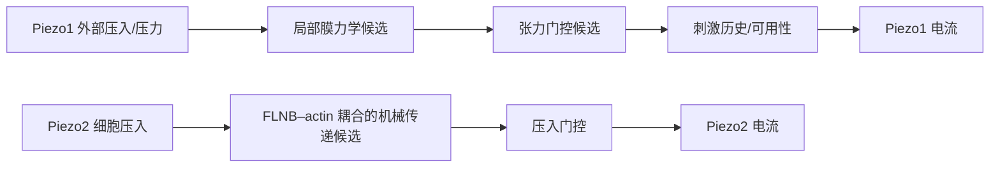

# 通道特异机械模块：当前证据与接口

日期：2026-09-27。本文记录已完成的独立数据审计，不修改 Duke 预测器。

| 模块 | 独立数据目前支持什么 | 尚不能输入 Duke 的量 |
| --- | --- | --- |
| Piezo1 外部力→局部张力变化 | [ETH Stepwise](eth_stepwise_report.md)：本体系下的 FLIM 张力变化量级 | Duke 的绝对局部张力、细胞个体转换系数 |
| Piezo1 张力→开放倾向 | [eLife patch 数据与首版审计](mechanistic_tension_simulator_report.md)：Piezo1 `T50/k` 量级 | Duke 单次校准的真实 `T0,λ,G` |
| Piezo1 刺激历史→峰值可用性 | [2026 wedge 数据](wedge_source_data_report.md)：短间隔重复压力使 WT 峰值下降，wedge 缺失削弱下降 | 可移植至 Duke 5 s 的唯一恢复时间常数 |
| 速度→机械保持期力松弛 | [2026 wedge AFM 数据](wedge_source_data_report.md)：N2a 速度改变力松弛时间及残余力 | 速度→Piezo 电流峰值/失活时间的直接函数 |
| Piezo2 FLNB 耦合→压入敏感性 | [2026 Nature 扰动数据](piezo2_flnb_source_data_report.md)：FLNB-KO 提高压入阈值、降低峰电流密度 | 玻璃探针 μm 到 Duke AFM nN 的转换、细胞 FLNB 耦合强度 |

[约束接口](external_mechanics_constraints.py)只返回实验支持的条件与单位；超出压力间隔/AFM 速度范围会拒绝外推。Duke 的[1→2→3-shot 审计](effective_force_kshot_report.md)保留为输入协议和参数可辨识性结果。现阶段不再由 Duke 的相近强度顺序刺激拟合更复杂的静态 sigmoid 或恢复率。

以后若测试跨体系约束的预测收益，必须先确定输入量可比性。Piezo1 需要同一细胞的 AFM 力、局部膜张力与电流，最好改变保持时间和间隔顺序；Piezo2 需要在同一压入几何下比较 FLNB 扰动、力轨迹与电流。现有 Source Data 已足够约束**扰动方向和机械松弛量级**，尚不足以给一个统一的 `F→I` 正向模型赋全部物理参数。
