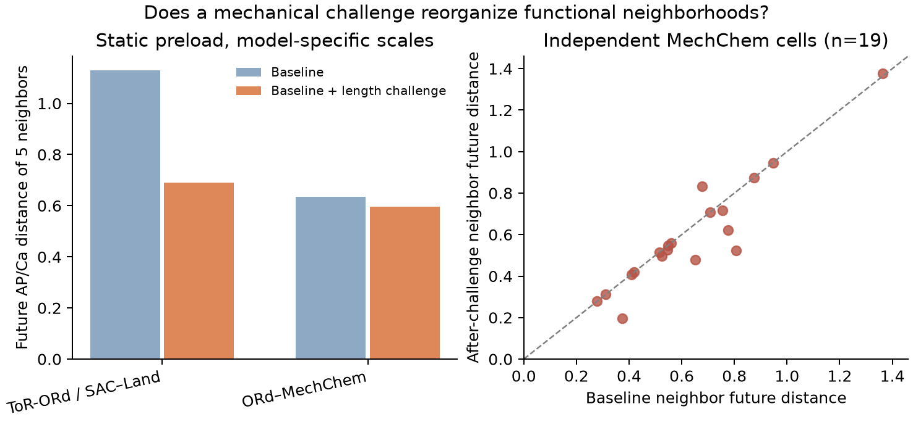

# 独立人源闭环模型检验：功能邻域是否跨方程保留？

日期：2026-10-02。**预设主门槛未通过；不能宣称发现跨人源模型普适的低维力电功能状态。** 在第二模型中，机械挑战仍携带少量有用信息，但未来 AP/Ca 邻域改善很小，按细胞重抽样的区间跨零；源模型训练的 5 维坐标未能有效迁移。这个负结果限定了现阶段流形/高阶网络路线的边界。

## 为什么这个真值模型独立？

以已发表的 [ORd–MechChem 双向模型](https://doi.org/10.1152/ajpheart.00275.2020)为第二真值。它把 O’Hara–Rudy 人心室电模型与 MechChem 肌丝/横桥模型耦合，机械反馈主要由动态 Ca–troponin 结合传给游离 Ca；它**没有**现有 ToR-ORd/SAC–Land 分支的直接 SAC 电流。两者因此在机械与反馈方程上有实质差别，但离子模型有 ORd 谱系关联，不是完全独立的电生理架构。

作者在 [Figshare 补充材料](https://doi.org/10.6084/m9.figshare.12571949)公开了源码；3.04 GB ZIP 里只提取所需的约 21 KB MATLAB 源码与 521 B 初始状态，没有下载两个巨大的预计算 `.mat`。原始文件见 [`external/mechchem_2020_code`](../external/mechchem_2020_code/PROVENANCE.md)，实验复制与可运行代码见 [`mechchem_cross_model`](mechchem_cross_model/run_static_cohort.m)。

两模型采用同一个**静态预负荷**定义：λ=1.000 基线，λ=1.050 校准，λ=1.075 和 1.100 为封存的未来负荷。B 模型参考肌节长度 2100 nm。A 模型使用既有 64 个细胞的参数/预起搏状态；B 模型重新用 8 个 MechChem 参数的 Latin-hypercube 抽样产生 20 个虚拟细胞，19 个在四负荷下通过数值 QC。**这不是原先 300 ms 短脉冲协议的精确复现。** 原生 MechChem 边界支持静态长度；把短脉冲硬施加于该实现时会产生负张力，故短脉冲轨迹没有进入分数。

冻结规则在 B 队列结果揭晓前写入[协议文件](cross_model_static_protocol.md)：5 个近邻；主未来终点为 APD、游离 Ca 与电压特征的两种封存负荷响应，排除张力；另外报告 Ca-only、AP/Ca/T、挑战打乱、A→B 五维 PLS 和 B 模型内部留一交叉验证。B 的标准化因子只用于其内部邻域分析；A→B 测试严格使用 A 的训练尺度与系数。

## 主结果

距离均为**各模型群体内部标准化**后的未来功能距离；A 与 B 的绝对数值不可当成同一物理量直接相比，主要看每模型内的变化。括号是按细胞配对重抽样的 95% 区间。`p_shuffle` 是 1000 次细胞间随机置换校准挑战的单侧经验值，主要验证挑战身份是否携带信息。

| 未来终点 | 模型 | 基线近邻 | 基线＋挑战近邻 | 改善（95% 区间） | 判定 |
|---|---|---:|---:|---:|---|
| AP/Ca 主终点 | A，64 细胞 | 1.129 | **0.690** | 0.439 (0.379, 0.497) | 模型内明确 |
| AP/Ca 主终点 | B，19 有效细胞 | 0.634 | 0.597 | 0.037 (−0.003, 0.081) | **跨零，未过 GO 门槛** |
| Ca-only | A | 1.275 | **0.765** | 0.511 (0.437, 0.585) | 不由 APD 截断单独驱动 |
| Ca-only | B | 0.753 | 0.706 | 0.046 (−0.001, 0.100) | 趋势相同，区间跨零 |
| AP/Ca/T 次终点 | B | 0.626 | **0.596** | 0.030 (0.011, 0.055) | 含张力时有较小改善 |

B 主终点的挑战打乱 `p_shuffle≈0.001`，但 19 个细胞中只有 8 个近邻表现改善、8 个近邻集合不变、3 个恶化。置换检验排除了“随机指派别人的挑战轨迹也同样有效”，并没有消除小样本效应不稳定的问题。主判断按**预先设定的细胞重抽样区间**执行，因此是 NO-GO。

进一步把 **A 的观测尺度**原样用于 B，B 主终点改善只剩 0.012，挑战打乱 `p≈0.236`。A 训练的 5D PLS 在 B 上误差 2.915，A 训练的基线 3D PLS 为 2.967，而“未来响应为零”的简单基线是 **2.066**。这些数值使用 A 的目标尺度，不能与 B 内部 CV 数值混比。B 内部重新留一训练时，基线 3D PLS 为 0.351，挑战 5D 为 0.116；它显示 B 模型内机械观测有预测信息，**不等于 A→B 表征迁移成功**。完整预定分数见[结果 JSON](mechchem_cross_model/output/cross_model_static_score.json)，算法见[评分脚本](score_cross_model_static_geometry.py)。

## 生物物理解释与质量检查

两模型对加长肌节的张力/Ca 方向相近，但电响应差得很大。λ=1.05 相对基线的平均变化：A 的 APD +50.1 ms、Ca 峰 −0.052 µM、张力峰 +10.17；B 的 APD +1.68 ms、Ca 峰 −0.038 µM、张力峰 +6.22。到 λ=1.10，A 按 1000 ms 截断后的平均 APD 增量约 +341 ms（真实均值可能更大），64 个细胞中 24 个在观察窗内未复极；B 平均仅 +4.53 ms，19 个有效细胞均复极。A 含直接 SAC，而 B 在公开实现中没有此通路；**这与**电响应差异一致，但这组比较不能单独把全部差异因果归给 SAC，因为电/机械底座和初始条件也不同。

数值检查：B 作者积分步长 0.001 ms；本队列使用 0.002 ms。在名义 λ=1.05 条件下，两步长的 Ca 峰差约 0.00005 µM、张力峰差约 0.01，采样波形的平均绝对差分别约 0.00004 µM 和 0.005 张力单位。0.003–0.02 ms 的粗步长产生发散，未用于分析。名义 λ=1.00 条件第 1→2 搏的 Ca 峰变化约 0.4%、张力峰约 1.2%、APD 3 ms。该稳态核查只针对名义个体；B 其余参数个体并未逐一长时间预起搏。20 个 B 细胞中 1 个在较高负荷出现不合格轨迹，按冻结 QC 排除并如实计数。A 的未复极 APD 预先按 1000 ms 右截断；Ca-only 敏感性分析绕开了该量。

## 去留判定

**NO-GO：目前不把“跨模型普适的功能信息流形”或 A 学到的 5D 坐标作为主张，也不据此添加 hypergraph。** 可以保留更窄的表述：在两套模型内部，机械长度观测都可能有个体预测信息；加入张力后 B 的邻域改善较稳定，但对未来电/Ca 的跨模型增益没有达到预设稳定性标准。此前同方程强结果依赖其 SAC–Land 反馈形式和协议，不能直接升格为心肌力电系统的一般性质。

这还是一个**合成、小样本、静态预负荷**比较。A 与 B 的初态/起搏准备不同，B 只改变八个力学参数且有一个高负荷失败，A 与 B 不可逐参数配对；原来的急性相位脉冲未跨模型复现。真实验证仍缺同一人源样本的基线、机械校准与封存挑战的同步 AP/Ca/力记录。所需最小接口及 QC 见[真实实验接口](minimal_real_mechanical_challenge_interface.md)。
