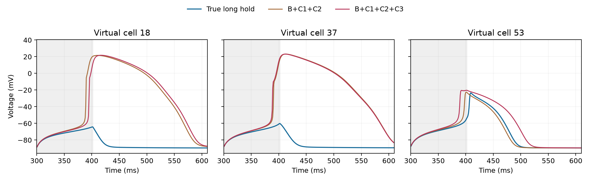

# Risk-aware 多时间尺度 C3：开发选择与新种子盲测

日期：2026-10-02。[预先冻结方案](dynamic_c3_protocol.md)在生成 C3 轨迹与新种子队列评分前写入。本实验只研究**已知正确饱和 SAC 形式条件下**的生理状态反演；没有使用旧确认队列的 8/18/43/57 号细胞来挑选 C3。所有细胞及波形仍是同一人源 ToR-ORd/SAC–Land 方程核心生成的合成数据。

## 候选与 QC

固定伸长峰值 `λ=1.10`、1 ms 上下坡；候选是在 150 或 600 ms 开始，保持 20、35 或 50 ms。封存预测目标仍为 300 ms 开始的 100 ms long hold。

在原本通过 baseline/C1/C2/long-hold QC 的 47 个开发细胞上，六个 C3 真值轨迹的通过数：

| C3 起始 / 保持 | 20 ms | 35 ms | 50 ms |
|---|---:|---:|---:|
| 150 ms | 24/47 | 8/47 | 6/47 |
| 600 ms | **47/47** | **47/47** | 44/47 |

早相位的较长保持在这个模型和既定 QC 下大量失败。不能只删去失败细胞后比较“成功者”的 MAE，因此仅 late-20 和 late-35 进入开发集前向预测比较。这里的失败是数值/生理范围 QC 事件；尚未验证其对应真实人心肌的异常兴奋。

## 边界处理：没有简单修复

对相同 PLS20、相同五折按细胞划分，比较旧的归一化参数 hard clip 与 `logit(θ)` 回归后 sigmoid 返回范围。开发集 B+C1+C2 的归一化 13 参数平均误差分别为 **0.115** 与 **0.140**；精确落在参数边界的预测比例为 **8.0%** 与 **0%**。logit 确实解决了“精确卡边界”，却没有提升一般参数反演。

更关键的是交叉拟合估计值送回原生 ODE 的 long-hold 结果：

| 无 C3 inverse | 原生预测通过 | 通过者 CVaR90（mV） | 通过者 mean（mV） |
|---|---:|---:|---:|
| Hard clip | **45/47** | 22.81 | 2.79 |
| Logit bounded | 42/47 | **5.58** | **1.06** |

logit 通过者的尾部误差较低，但多失败 3 个细胞。由于比较集合不同，不能据此宣称 logit 更鲁棒；按冻结的“先失败数、后 CVaR”规则，选择 hard clip 进入 C3 选择。这也说明简单 bounded parameterization **没有经本轮证明能修复整个尾部问题**；hard clip 的边界失败仍是后续方法学问题。

在 hard clip 下，late-20 原生预测通过 **46/47**，late-35 为 **44/47**；无 C3 为 **45/47**。late-35 虽有较低的通过者 CVaR90（13.59 mV），却比无 C3 多一个失败，因此按冻结规则排除。late-20 的通过者 CVaR90 为 22.02 mV，与无 C3 的 22.81 mV 非配对比较改善很小；在 **45 个共同通过细胞**上重算为 **22.81→20.51 mV**。因此冻结 late-20，且把它视为仅有弱开发信号的候选。

## 全新随机种子盲测：固定 C3 未通过

先冻结 inverse、候选和评分，再以 `20261009` 新种子生成 64 个独立合成细胞。64/64 基础预起搏成功；48/64 同时通过 baseline/C1/C2/C3/long-hold 真值 QC。封存目标的真值 QC 是主要排除来源。用 47 个开发细胞训练的固定 PLS20 hard clip 分别从 B+C1+C2、以及 B+C1+C2+late-20 C3 推断新细胞参数，重新预起搏，再在正确饱和 SAC 方程下盲预测 long hold。无 C3 的原生预测 44/48 通过；有 C3 的 45/48 通过。主结果在 **44 个共同通过细胞**上配对计算：

| 指标 | B+C1+C2 | 再加 late-20 C3 |
|---|---:|---:|
| V MAE 均值 | 2.664 mV | 2.805 mV |
| 中位数 | 0.142 mV | 0.143 mV |
| p90 | 0.669 mV | 0.676 mV |
| **CVaR90** | **22.151 mV** | **23.312 mV** |
| 超过 5 mV 的细胞数 | **2** | **3** |
| 第二次上冲 presence mismatch | 2 | 2 |
| `D > −50 mV` 绝对时长误差 | 8.27 ms | 9.09 ms |

配对 CVaR90 差（有 C3 减无 C3）为 **+1.162 mV**，按细胞 bootstrap 的 95% 区间 **+0.061 至 +2.936 mV**。44 个细胞里 20 个的 V MAE 改善，24 个变差。两个最严重个体 18、37 号分别约 **51 和 54 mV**，加 C3 后仍然如此；53 号从 2.58 升至 7.22 mV。真值只有 2/44 个在目标窗口上穿 −50 mV，两个模型各产生 2 个额外上冲；因此 crossing-time 的有限样本均值不能作为强证据。

事后仅作诊断，C3 后的 13 参数归一化平均误差为 **0.129**，无 C3 为 **0.124**；IKr 为 0.154 vs 0.121、INaL 为 0.243 vs 0.218、反馈增益为 0.019 vs 0.021。这与“C3 略改善反馈强度，但没有约束引发大尾部错误的部分离子方向”相容，不能当作前瞻选择理由。精确边界比例约 7–8% 仍在。

## 决策及限制

**NO-GO：这一个固定、多时间尺度 C3 没有降低新种子 long-hold 尾部风险。** 它在开发集只提供弱收益，盲测下 CVaR 和 `>5 mV` 失败数都变差。不能把本结果说成“任何第三次探针无用”：只检验了受 QC 限制的一个固定 late-20 协议、一个 47 细胞开发队列和一个 48 细胞可评分新队列；早相位与 late-50 在既定 QC 下不适合公平评估，late-35 被失败率门槛排除。

目前更合理的下一问题是：**能否仅根据 B+C1+C2 的不确定性，为不同细胞选不同 C3，并在全新封存队列中降低长时尾部风险？** 例如 8/43 号曾指向离子通道方向，57 号指向反馈强度；一个固定 probe 未必同时约束两类方向。这个自适应假设尚未验证。也不应因固定 C3 失败而直接上 UDE：本轮仍存在明显的个体生理参数误差和模型内回代失败。

## 复现文件

- [冻结协议](dynamic_c3_protocol.md)
- [C3 真值生成](generate_dynamic_c3_extra.m)、[新种子参数与预起搏](generate_dynamic_c3_fresh_source.m)
- [开发集反演](prepare_dynamic_c3_inverse.py)、[开发集原生预测](run_dynamic_c3_development_targets.m)、[开发集选择](score_dynamic_c3_development.py)
- [新种子反演](prepare_dynamic_c3_fresh_inverse.py)、[新种子原生预测](run_dynamic_c3_fresh_targets.m)、[盲测评分](score_dynamic_c3_fresh.py)
- [开发集逐细胞结果](human_bidirectional_output/dynamic_c3_development_scores.json)、[盲测逐细胞结果](human_bidirectional_output/dynamic_c3_fresh_scores.json)
