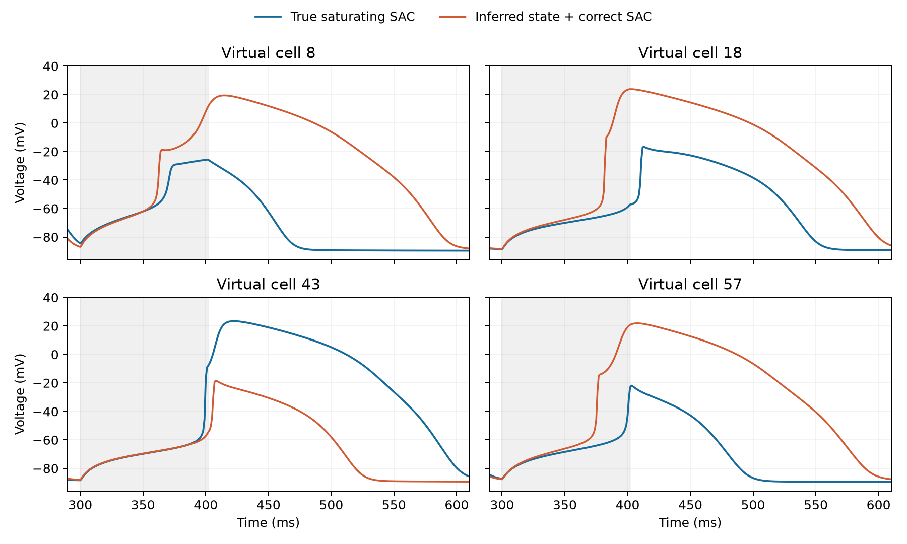

# Long-hold 尾部失败的状态与参数路径审计

日期：2026-10-02。此分析只诊断此前已封存确认队列中的高误差细胞；真参数用于 oracle 路径和替换，**没有**进入部署式个体化预测。真值是同一 ToR-ORd/SAC–Land 核心下的饱和 SAC 合成模型。

## 为什么只审计这四个细胞

在 44 个共同 QC 细胞中，正确饱和 SAC + baseline/C1/C2 推断参数的 long-hold 目标窗口 V MAE：均值 **3.731 mV**，中位数 **0.244 mV**，第 90 百分位 **2.071 mV**，最差 10%（5 个细胞）的均值 CVaR90 **30.192 mV**。其中 8、18、43、57 号四个细胞的误差分别为 42.13、31.71、34.77、40.07 mV；它们贡献总误差的 **90.6%**。其余 40 个细胞均值只有 **0.388 mV**。因此总体均值描述的是尾部风险，不能说成全群体普遍失准。

## 波形上到底错在哪里

四个细胞在机械保持阶段都产生第二次电压上冲；预测也产生上冲，但其峰值或复极平台持续时间错误。用目标窗口中高于 −50 mV 的时长作一个直观描述：

| 虚拟细胞 | 真值第二次上冲跨越 −50 mV 时刻 | 预测时刻 | 真值高于 −50 mV 时长 | 预测时长 |
|---|---:|---:|---:|---:|
| 8 | 367 ms | 361 ms | 72 ms | 202 ms |
| 18 | 409 ms | 380 ms | 109 ms | 192 ms |
| 43 | 398 ms | 404 ms | 177 ms | 87 ms |
| 57 | 398 ms | 374 ms | 62 ms | 186 ms |

这些是模型内电压轨迹事件；不能直接称作临床心律失常。旧的第一搏 APD 指标对这类机械诱发后续事件并不敏感，例如 8 号细胞的第一搏 APD 沿参数路径只在约 278–284 ms 变化，却有数十 mV 的 long-hold 波形误差。

## 真参数路径

固定正确的饱和 SAC，按 `θ(s)=θ̂+s(θtrue−θ̂)` 插值；中间点从同细胞真值初态重新预起搏 100 次，两个端点沿用原先各自的预起搏状态。每一步重新运行原生 ODE 的静息与 long-hold 条件，按照已锁定的基线对齐和目标窗口评分。V MAE（mV）：

| 细胞 | s=0 | 0.25 | 0.50 | 0.75 | s=1 |
|---|---:|---:|---:|---:|---:|
| 8 | 42.13 | 43.66 | 9.67 | 3.86 | ≈0 |
| 18 | 31.71 | 31.25 | 30.59 | 29.80 | ≈0 |
| 43 | 34.77 | 8.12 | 3.82 | 1.67 | ≈0 |
| 57 | 40.07 | 40.20 | 21.29 | 6.56 | ≈0 |

8、43、57 号对参数改变高度非线性，但在该粗网格中不能严格定位分岔点。18 号到 0.75 仍约 30 mV；下一节的 200 搏审计显示它不是中间点预起搏不足造成的。`s=1` 约零是同方程真参数回代的 oracle 恒等结果，不是独立验证。

## 参数组和组内诊断

参数组事先按生理作用划分：离子通道 = CaL、IKr、IK1、INaL；Ca handling = SERCA、NCX；机械 = ca50、TRPN_n、nperm、β0、Tref；反馈 = g_ionic、β1。下表从 `θ̂` 出发，只把该组替换为真值，重新预起搏 100 次，再跑 long hold。数字为 V MAE mV。

| 细胞 | 全部估计 | 离子通道真值 | Ca handling 真值 | 机械真值 | 反馈真值 |
|---|---:|---:|---:|---:|---:|
| 8 | 42.13 | **0.45** | 41.69 | 42.50 | 41.69 |
| 18 | 31.71 | 28.80 | 31.74 | 31.95 | **22.78** |
| 43 | 34.77 | **4.79** | 27.89 | 37.55 | 53.05 |
| 57 | 40.07 | 21.89 | 40.06 | 40.20 | **8.69** |

针对最有效组做有限的单参数替换：

- **8 号：INaL** 单独换真值后 42.13→**5.65** mV；CaL 单独替换仍 41.56，IK1 仍 42.46。IKr 单独替换的轨迹未通过既定生理 QC，不能给它赋予误差值。完整离子通道组可降至 0.45 mV。
- **43 号：IKr** 单独替换后 34.77→**2.02** mV；CaL→7.59，IK1→4.00，INaL 反而→53.5。将六个离子/Ca 参数一起替换为 5.06 mV，说明这些替换效应不可加。
- **57 号：g_ionic** 单独替换后 40.07→**6.91** mV；β1 单独替换仍 40.10。
- **18 号：g_ionic** 单独替换 31.71→**24.17** mV，β1 几乎不变；离子通道加反馈六参数联合替换仍约 23.25 mV。其长时错误不由一个已试参数方向单独解释。

特别注意，8、43、57 号的推断 IKr 恰在先验下界 **0.85**，而真值分别为 0.879、1.085、0.904；18、43 号的推断 INaL 恰在下界 **0.80**，真值为 1.102、1.017。PLS 的归一化输出在写回生理参数前被截断到先验边界。这是值得进一步检查的逆模型失败模式，不能把边界碰撞直接解释成真实细胞参数在边界。

## 完整状态预起搏审计

从既有估计或真实参数的预起搏状态继续以更严格容差积分 20、50、100、200 搏，记录全部 50 个状态分量的相邻周期相对 RMS，并在每个检查点重新预测 long hold。

| 细胞 | 推断参数追加 0 搏 | 追加 200 搏 | 真参数追加 200 搏 |
|---|---:|---:|---:|
| 8 | 42.13 | 42.43 | 1.34 |
| 18 | 31.71 | 31.99 | 3.01 |
| 43 | 34.77 | 33.88 | 0.095 |
| 57 | 40.07 | 40.23 | 0.181 |

追加 200 搏时，估计参数的完整状态相邻周期相对 RMS 约 `4×10⁻⁶–2×10⁻⁵`。18 号的 `s=.75` 中间点追加 200 搏，误差仍 **29.82 mV**。故预起搏不足不能解释 30–40 mV 的主要尾部错误。不过，真实参数轨迹在更严格求解下也会移动，尤其 18 号约 3 mV；原模型的真值本身并非对所有数值细节完全不敏感。这里既不宣称已经证明严格渐近周期收敛，也不宣称出现了数学意义的分岔。

## 科学判断与下一关

这次审计把 long-hold 尾部失败缩成了更具体的问题：**个别细胞的机械诱发第二次电压事件，对任务相关的离子/反馈参数组合高度敏感；短探针 C1/C2 及按平均 13 参数误差选择的逆模型，没有稳定约束这些方向。** 四个细胞的主导方向不一致，因此不能用一个全群体单参数修正概括。

下一步 C3 必须在开发队列设计、并用全新随机种子的细胞封存验证；不能在这四个已看过真值的确认细胞上选最有利的时长。合理候选是中等幅度、20–50 ms 的机械保持，在选择时直接衡量对第二次上冲时刻/平台持续期和 long-hold 尾部误差的预测信息，而非平均参数 MAE。最终同时报告 mean、median、p90、CVaR90 与 QC/失败率。只有当多时间尺度探针和已知机制选择仍留下可重复的模型形式残差，才值得引入 UDE。

## 可复现文件

- [路径、组替换与组内诊断脚本](run_dynamic_longhold_tail_audit.m)
- [严格状态审计脚本](run_dynamic_tail_state_audit.m)
- [作图脚本](plot_dynamic_longhold_tail.py)
- [路径与组替换原始结果](human_bidirectional_output/dynamic_longhold_tail_audit.mat)
- [单参数原始结果](human_bidirectional_output/dynamic_longhold_tail_followup.mat)
- [状态审计原始结果](human_bidirectional_output/dynamic_tail_state_audit.mat)
