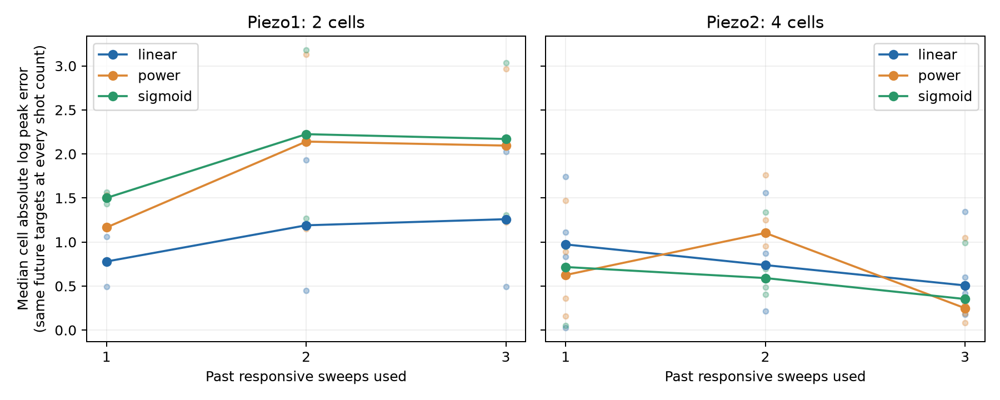
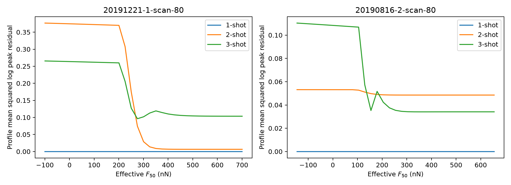

# Duke 力域重参数化与 1→2→3-shot 前瞻检验

日期：2026-09-27。**结论：在现有严格队列中，更多同细胞响应尚未让 Piezo1 的有效 sigmoid 比简单力模型更好预测未来峰值；两次或三次响应也未稳定识别曲线参数。** Piezo2 有探索性收益，但缺独立 Piezo2 张力门控先验，且可做三次校准的细胞很少。

## 力域形式与可辨识性

原始门控函数严格等价于

`σ((T0 + λF − T50)/k) = σ((F − F50_eff)/sF_eff)`，其中

`F50_eff = (T50 − T0)/λ`，`sF_eff = k/λ`。

这只是代数重写，不增加 Duke 的物理观测。即使外部实验固定 `T50,k`，单个首次响应峰值也只有一个幅度约束，不能同时确定细胞增益、`F50_eff` 和 `sF_eff`。若未来有足够多、强度不同且状态稳定的刺激，力域曲线可能被估计；这批刺激不应事先被假定足够。以下只报告**有效力域参数**，不给 Duke 细胞赋真实 `T0`。

峰值模型在首次响应力 `Fth` 处作操作性基线扣除：`h(F)=[σ((F−F50_eff)/sF_eff)−σ((Fth−F50_eff)/sF_eff)]_+`。因此 `F50_eff` 是未扣除 sigmoid 的形式半激活位置，**不是观测到的电流峰值半高力**；`Fth` 也是响应检测力，不是直接测得的通道开放阈值。ETH 和 eLife 的数值仍提供不同体系中的量纲/物理参照，不能把 ETH 的传递斜率固定给 Duke 或把 Piezo1 的 patch 曲线赋给 Piezo2。

## 前瞻协议

- 复用既有 −80±5 mV、带符号电流和刺激前 QC 的 Duke 队列，不改接触点、基线或筛选。Piezo1：9 个细胞、20 个未来 sweep、6 个日期；Piezo2：10、23、3。
- 每折留出**整个日期**。只用其他日期的细胞选择总体幂律指数 `γ`、sigmoid 的总体 `F50_eff−Fth` 与宽度 `sF_eff`。留出日期的每个测试细胞按 sweep 顺序开放 1、2、3 次已观测响应；被预测 sweep 必须晚于全部校准 sweep。
- sigmoid 的候选 `sF_eff` 为 25–450 nN；eLife Piezo1 中位斜率除以 ETH 平均力传递斜率约为 **98 nN**，只用于确定宽量级搜索范围，**没有固定 Duke 的转换系数**。候选 `F50_eff−Fth` 为 −200 至 600 nN，幂律 `γ` 为 0.25 至 4。每折总体形状均由训练日期选定；Piezo1 有一折把总体半激活力选到 600 nN 上界，提示范围敏感性。
- 三个模型均用同一个首次响应检测力：线性力 `A(F−Fth)_+`；幂律 `A(F−Fth)_+^γ`；有效 sigmoid `A h(F)`。第一次校准估幅度；从第二次起，线性力更新幅度，幂律更新 `γ` 与幅度，sigmoid 在**其他日期选定的固定 `sF_eff`** 下更新 `F50_eff` 与幅度。后两者各增加一个细胞特异形状自由度。校准的目标函数是对数峰幅残差平方；零/极小峰值在取对数前以 1 pA 下限处理。没有借用未来目标电流。
- 主终点是未来 sweep 的峰值电流绝对对数误差 `|log(1+Itrue)−log(1+Ipred)|`；同时保存 pA 绝对误差。此轮只检验**幅度迁移**，不以全波形 MAE 混淆时序与衰减。
- 横跨 shot 数的学习曲线只评价**同一批未来目标**，即第三次校准之后的目标。否则每个 shot 的测试细胞和目标都变了，不能把中位数变化解释为多看一次的效果。另保存各 shot 所有可用目标，供样本覆盖审计。

固定队列的容量很有限：1-shot Piezo1/Piezo2 各有 9/10 个细胞；2-shot 各 5/7 个；3-shot 只有 **2/4 个**。共同未来目标分别为 **6/6 条**，故这是一项小样本可行性检验，不是精确的群体性能估计。

## 相同未来目标上的结果

表内是每细胞先平均未来目标误差，再取细胞中位数。单位是绝对 `log1p` 峰值误差；越低越好。Piezo1 仅 2 个、Piezo2 仅 4 个独立细胞。

| 通道 | 模型 | 1-shot | 2-shot | 3-shot |
| --- | --- | ---: | ---: | ---: |
| Piezo1 | 线性力 | **0.779** | **1.190** | **1.259** |
| Piezo1 | 幂律 | 1.165 | 2.141 | 2.095 |
| Piezo1 | 有效 sigmoid | 1.500 | 2.225 | 2.170 |
| Piezo2，探索性 | 线性力 | 0.973 | 0.738 | 0.508 |
| Piezo2，探索性 | 幂律 | **0.626** | 1.103 | **0.249** |
| Piezo2，探索性 | 有效 sigmoid | 0.716 | **0.591** | 0.353 |

Piezo1 在这两个细胞上，2/3-shot 的非线性模型相对同时点线性力均未改善，且更多校准没有形成单调下降的误差曲线。Piezo2 的 3-shot 幂律在 3/4 个细胞胜过线性力，sigmoid 也在 3/4 个细胞胜过线性力；但**sigmoid 没有胜过幂律**，也不能当作 Piezo2 张力门控机制的证据。因为细胞数小、日期相关，不能从这些差异计算可信的普适优劣结论。

只看每个 shot 全部可用目标会得出不同中位数，但样本构成不断收缩。相应逐 sweep 预测与每细胞拟合全部保存在 CSV，不把这种不平衡比较作为主结论。

## Profile loss：增加观测不保证信息量

对一个 Piezo1 长序列和一个 Piezo2 机械强度跨度较大的序列，固定 `F50_eff` 网格、在每点重新优化 `sF_eff` 和幅度 `A`，绘制校准峰值**平均平方对数残差**。这叫 profile **loss**；未指定完整噪声模型，不能称正式 profile likelihood 或给置信区间。示例细胞按序列长度/强度跨度选取，未按预测成绩挑选。

1-shot 在整个 800 nN 搜索区间完全平坦，因为自由幅度可以精确配准唯一的观测峰值。Piezo1 示例 2-shot 在 `最小损失+0.01` 下仍覆盖 **375 nN** 的 `F50_eff`，3-shot 覆盖 **425 nN**，未继续收窄。Piezo2 示例 2-shot 覆盖整个 **800 nN**，3-shot 仍覆盖 **500 nN**。两次幅度观测只提供一个峰值比值，而完整 sigmoid 的 `F50_eff,sF_eff,A` 有三个自由参数，所以 2-shot profile 出现一个好看的最低点也不能证明唯一识别。3-shot 理论上提供第二个比值，但相近刺激强度、噪声和随 sweep 改变的细胞状态会使实际曲线继续宽广。

实际记录也提示超出静态 `Fpeak→Ipeak` 的因素。例如一个 Piezo2 细胞未来三次刺激的峰力约 **501、520、512 nN**，峰电流却约 **160、285、509 pA**；不能仅凭此判定原因，可能涉及局部载荷传递、接触几何、可用通道数/状态或记录因素。另一个 Piezo1 长序列中，用于第二次校准的未来响应约 **22 pA**，基线噪声约 **6.5 pA**，使追加观测也可能给个体曲线带来不稳定信息。这里没有事后删去这些 sweep。

## 当前判断

用户提出的力域重参数化是正确且必要的。它把“拟合出一个貌似合理的 `T0`”转成了可审计的问题：**哪些力域曲线参数在给定刺激协议下可由现有记录识别？** 本次 1/2/3-shot 结果没有证明 Piezo1 的 sigmoid 机制错误，但也不支持“多给两次过去响应就能稳定救回完整幅度预测”。对这批数据，增加独立刺激强度的同时，还需关注状态/几何是否随 sweep 改变；前瞻实验最好有随机化或重复的同强度刺激，并尽可能同步测局部膜张力或其他中间层。

复现入口：[代码](effective_force_kshot.py)；输出：[学习曲线](effective_force_kshot_learning_curve.png)、[profile 图](effective_force_kshot_profiles.png)、`effective_force_kshot_folds.csv`、`effective_force_kshot_cell_fits.csv`、`effective_force_kshot_predictions.csv`、`effective_force_kshot_profiles.csv`。有关不同刺激协议改善可辨识性的离子通道建模背景，参见 [Milescu 等原始研究](https://pmc.ncbi.nlm.nih.gov/articles/PMC1305347/)；本文的结论以 Duke 本队列的前瞻评分为准。
