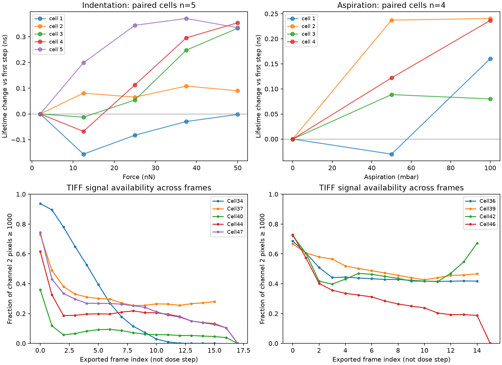

# ETH Stepwise Flipper-TR：局部机械输入到膜张力变化

日期：2026-09-27。已审计本地 `StepwiseFlipperTrImaging.zip`，并以[论文官方 Figure 2 数值源表](https://www.nature.com/articles/s41592-024-02277-8)做同细胞配对计算。这里的 `ΔT` 是 ETH HFF-1/FluidFM 条件下的**局部张力变化**；不是 Duke 细胞的绝对 Piezo 门控张力。

## 数据和独立单位

- Stepwise 压缩包约 4.21 GiB，解压后含 10 个 `.lif`（包括 Fig. 2c 全细胞代表图）和 1,118 个 `.tif`。用于逐级刺激的 TIFF 是 **5 个压入力细胞、4 个吸力细胞**，共 147 帧，每帧导出 ch0–ch3，另有部分重复导出的 ch2。Leica XML 记录 `xyt` 扫描，帧时间 **10.2 s**，图像 **64×256** 像素。
- 官方 `SourceData_Fig2f` 中 **5 个细胞×5 个力档**是同细胞配对序列，力为 2、12.5、25、37.5、50 nN；另外 5 行 0 nN 来自 **另外 5 个细胞**，不能误作前述细胞的第 0 步。`SourceData_Fig2g` 为 **4 个细胞×3 个吸力档**，在 25 nN 压入力下分别施加 0、50、100 mbar。
- 本地 XML 没有标注导出 TIFF 的 ch0–ch3 物理量/单位，也没有每帧与机械力档的完整对应表或独立的同步 AFM 数值轨迹。因此已发表源表提供可复核的 ROI 寿命数值；当前 TIFF 用于原始图像 QC，**尚不能独立复算论文的每个 ROI 寿命**。

## 同细胞效应

每个细胞用自身第一力档作基准；斜率先在每个细胞内拟合，再跨细胞平均。寿命到张力的换算使用论文对 HFF-1 的标定 **1.325±0.392 (mN/m)/ns**，只适用于**寿命变化**。表中的 95% t 区间仅描述这些少量细胞斜率的不确定性，不能解决细胞选择和标定误差。

| 刺激 | 独立细胞 | 端点寿命变化平均 | 端点增加的局部张力估计 | 平均张力斜率 | 同细胞正斜率 |
| --- | ---: | ---: | ---: | ---: | ---: |
| 压入力 2→50 nN | 5 | +0.222 ns | **+0.294 mN/m** | **0.00698 mN/m/nN** | 5/5 |
| 吸力 0→100 mbar，固定 25 nN | 4 | +0.179 ns | **+0.238 mN/m** | **0.00238 mN/m/mbar** | 4/4 |

力档端点增加为 4/5 个细胞；一个细胞端点几乎不变但其五点拟合斜率略正。吸力端点增加为 4/4。压入力斜率跨细胞范围约 0.0011–0.0090 ns/nN，吸力斜率范围 0.00080–0.00241 ns/mbar；个体差异大，尤其压入力。由少量细胞的 t 区间得到斜率范围：力约 0.0010–0.0129 mN/m/nN，吸力约 0.00078–0.00397 mN/m/mbar，均未含寿命标定系数的不确定性。论文报告的总体斜率约 **0.0065** 和 **0.0024**，与本次按细胞平均的估计接近；拟合/加权定义不同，不要求精确相等。[原论文 Figure 2 与方法](https://www.nature.com/articles/s41592-024-02277-8)。

图的上半部是官方源表的逐细胞寿命变化；下半部仅显示本地 TIFF 通道 2 中达到 1,000 原始计数的像素比例。部分压入力序列随帧数明显变暗，且图像位置发生变化。论文对寿命拟合要求足够光子数，并采用膜区 ROI；因此**不能直接对整帧 ch3 取均值**，也不能把亮度下降误作张力降低。通道编号/单位仍需用 `.lif` 或作者提供的导出说明确认。[论文 FLIM 方法](https://www.nature.com/articles/s41592-024-02277-8)。

## 对 Duke 模型的实际意义

1. **中间层终于有独立量纲约束。** ETH 在自身实验几何内支持“外力、吸力增加→局部膜张力增加”，可为潜在机械层设宽参数范围和正确量纲。
2. **一个平均张力标量还不足以直接解释激活阈值。** 两种刺激的平均张力斜率之比约 **2.94 mbar/nN**；先前 ETH 钙响应阈值模型的压入力等效量约 3.9 mbar/nN，原表 `pC,50` 的力斜率量级约 4.7 mbar/nN。**这是从不同测量和细胞组作的推断，不是统计上已证实的冲突。** 局部高张力面积、膜几何、通道数和钙读出都可能改变阈值；这与论文对共同刺激的讨论一致。[原论文 Figure 3 与机制分析](https://www.nature.com/articles/s41592-024-02277-8)。
3. **不能硬套到 Duke。** ETH 用 HFF-1 和 FluidFM 环形探针，Duke 用 HEK293T 上的 AFM 压入；两者力分布、形变和表达不同。将来可用 ETH 斜率作敏感性分析，Duke 的力→有效局部机械状态比例仍应是未知量。eLife patch 的 `T50` 是另一几何下的门控张力量级，也不能与这里的 `ΔT` 当作相同绝对量直接比较。
4. **Stepwise 解决慢/静态层，不解决毫秒动态。** 每帧 10.2 s，不能用来推断 Piezo1/Piezo2 的 1–10 ms 起始延迟；该问题仍由 Duke AFM–电流同步波形研究。

复现：[分析程序](analyze_eth_stepwise.py)、[数值 JSON](eth_stepwise_results.json)、[图像 QC CSV](eth_stepwise_tiff_qc.csv)。

## 独立力学比例能否预测钙阈值？

随后做了一个**事先固定比例**的交叉检验：从 Stepwise 的 5/4 个 FLIM 细胞得到 `αF/αp=2.94 mbar/nN`，只让钙阈值模型在训练重复中学习基准阈值和曲线陡度；每次留出一整个独立重复。这个比例不在钙阈值细胞上重新拟合。Brier 分数越小越好：

| 条件 | 仅吸力 | 固定 Stepwise 比例 | 在钙数据重新学习力比例 |
| --- | ---: | ---: | ---: |
| Control，n=220 | 0.1262 | **0.0857** | 0.0849 |
| Margaric acid，n=106 | 0.0881 | **0.0741** | 0.0733 |
| CytoD，n=73 | 0.1123 | **0.0956** | 0.0921 |

三个 Control 留出重复的固定比例 Brier 分别为 0.0923、0.0922、0.0740。**结论：在 ETH 自身几何中，独立测得的局部力学交换比例，足以保留阈值模型的大部分留出预测力。** 这比单独比较两组斜率更直接，但也不能证明 Piezo 门控只依赖平均局部张力：钙成像是下游二元读出，膜区受力面积和通道数未在此模型中观测。药物组使用未经重新标定的 Control 力学比例，只是探索性的转移检验。

该比例不精确：按 FLIM 独立细胞重新抽样，`αF/αp` 的 2.5%–97.5% 分位约 **1.26–5.48 mbar/nN**。这种小样本 bootstrap 只是敏感性提示，不能当作精确置信区间。Control 留出 Brier 对预设比例 2、2.94、4 mbar/nN 分别约 0.0942、0.0857、0.0825；因此数据能支持“外力确有独立贡献”，**不能精确识别唯一的力／吸力转换常数**。脚本：[固定比例检验](eth_stepwise_threshold_bridge.py)；[逐重复结果](eth_stepwise_threshold_bridge_results.json)。
