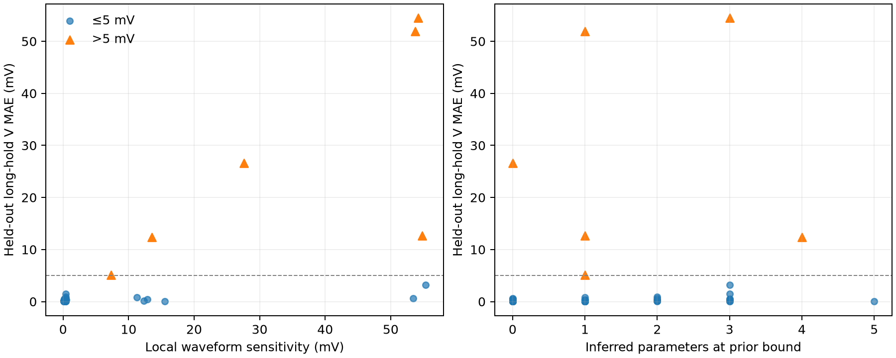

# 长时机械刺激风险预警：两个新种子队列的封存检验

日期：2026-10-02。研究对象是现有**同方程合成**人心室 ToR-ORd/SAC–Land 闭环模型。此分析延续
`dynamic_event_boundary_pilot_report.md` 的三例局部敏感性诊断，但没有用那三例训练或调节新风险分数。
第一队列的评分规则在生成它之前写入 `event_margin_confirmation_protocol.md`；看到首轮仅有两个严重事件后，
在生成第二队列之前又冻结了相同规则的 128 细胞复验。两个队列均未参与 47 细胞开发集的 PLS20 反演训练。

## 问题与方法

只从一个新细胞的 baseline、C1 和 C2 观测估计 13 维参数，重新预起搏，并用原生 ODE 预测尚未观测的
300 ms 起始、λ=1.10、100 ms 保持的 long-hold 协议。主错误为 300–602 ms 窗口的电压波形 MAE；
预先把 `>5 mV` 定义为严重误差。

目标盲风险分数：在**估计参数**附近分别把 IKr、INaL、有效离子机械反馈增益改变参数先验全宽的 ±2.5%，
沿用该估计细胞的预起搏状态，各跑一条 long-hold。六条扰动波形相对中心预测波形的最大 V MAE 即分数。
没有用真参数、封存 long-hold 观测或个体真实误差来计算分数。这是有限扰动的目标特异性敏感性代理，
**不是**后验概率、严格误差上界或可辨识性证明。与推断参数碰边界数、短探针重建残差、预测电压持续时间比较。
评估后另作更严格的简约性诊断：直接使用原生预测的第二次电压峰值，以及估计的反馈增益。

## 新队列结果

| 种子 | 合成细胞 | long-hold 真值 QC 通过 | 原生预测 QC 通过 | 共同可评分 | `>5 mV` |
|---|---:|---:|---:|---:|---:|
| 20261021 | 64 | 44 | 44 | 44 | 2 |
| 20261023 | 128 | 91 | 94 | 90 | 6 |

第一队列的真值和预测 QC 集合恰好一致。第二队列有 1 个真值通过而预测失败、4 个真值失败而预测通过。
下面的波形风险排序只针对共同通过者；**两队列原始细胞中分别有 20/64、37/128 个真值没有通过
long-hold QC**，不能把这些排除者藏在 AUROC 后面。

| 风险分数 | 首轮 AUROC / AP / 最高 10% 召回 | 复验 AUROC / AP / 最高 10% 召回 |
|---|---:|---:|
| 局部波形敏感性，预先固定 | **1.000 / 1.000 / 2/2** | **0.972 / 0.618 / 5/6** |
| 参数碰边界数，预先固定 | 0.577 / 0.073 / 0/2 | 0.686 / 0.181 / 2/6 |
| C1/C2 重建残差，预先固定 | 0.524 / 0.068 / 0/2 | 0.766 / 0.202 / 1/6 |
| 预测第二次响应持续时间，预先固定 | 0.738 / 0.523 / 1/2 | 0.897 / 0.588 / 5/6 |
| **预测电压峰值，事后简约性诊断** | 0.976 / 0.750 / 2/2 | 0.964 / 0.502 / **6/6** |
| **估计反馈增益，事后简约性诊断** | 0.964 / 0.500 / 2/2 | 0.952 / 0.608 / 4/6 |

复验中局部敏感性的单独 AUROC 按细胞 bootstrap 区间约 0.931–1.000。但更有关联的是**相对简单电压峰值
的增益**：配对 bootstrap 的 AUROC 差区间为 **−0.024 至 +0.044**，AP 差区间为
**−0.158 至 +0.454**，都跨零。首轮 AUROC 的 bootstrap 区间退化到 1.0 是因为仅有两个正例且二者
排序最高；它不能被解释为真实总体上的精确估计。

复验 90 个共同通过细胞中，风险分数最大的扰动方向**全部是有效离子机械反馈增益**，IKr 与 INaL 没有
成为任何一个细胞的最大项。分数因此在本队列上主要是反馈增益局部敏感性指标；不能声称我们发现了
三个机制方向的非平凡融合。最高分还包括低误差假警报，例如 85、19 号。严重误差 91 号为 5.10 mV，
排在敏感性分数前 9 名之外；它是预先固定的 10% 预算下的漏报。

固定复核预算也说明不能只看一个汇总数字：在复验队列的最高 3 名里，敏感性分数找到 2 个严重细胞，
预测峰值找到 0 个；最高 9 名里分别为 5/6 与 6/6。敏感性在极小预算的排序上可能有用，但目前没有
稳健证据表明它优于几乎零额外计算成本的预测峰值。敏感性分数每个细胞需要**额外六次原生 ODE
积分**，这个计算代价必须计入方法比较。

## 科学判断

**正面发现：** 两个独立新种子队列中，长时机械响应对估计参数的局部敏感性与严重预测错误有稳定关联。
短探针拟合残差本身很难识别这些尾部错误，说明校准拟合好并不保证长时反事实安全。这与先前
8/43 号细胞重新预起搏后仍存在陡变的观察方向一致。

**方法去留：** 这轮没有证明“新风险算法”成立。简单的原生预测峰值与单个反馈增益已经很强；局部
敏感性虽有略高的 AUROC/AP，但复验差值不确定，且在 10% 固定复核预算下漏掉了一个峰值方法捕获的
严重细胞。故**局部敏感性可保留为同模型诊断工具，不能作为论文主算法贡献**；不应沿这 134 个已
揭示误差的细胞调扰动半径、参数集合或组合权重来追求更好数字。

研究的下一道真正关卡是预先设计的**行动效用**，而不是继续优化风险 AUROC：对被标为高风险的个体，
是否能选出一个额外机械探针，校准后在全新队列真正降低 long-hold 的严重误差和 CVaR？必须同时与
“按预测峰值选择需要补测的细胞”及固定 C3 比较。还需要模型形式不同的真值；目前所有统计都来自
同一 ODE 家族，没有真实人细胞机械挑战验证。

## 可复现内容

- 冻结规则：`event_margin_confirmation_protocol.md`。
- 新种子与真值：`generate_event_margin_confirmation_source.m`、
  `generate_event_margin_replication_source.m`、`generate_dynamic_c3_extra.m`。
- 目标盲反演与预测：`prepare_event_margin_confirmation_inverse.py`、
  `prepare_event_margin_replication_inverse.py`、`run_event_margin_confirmation_targets.m`、
  `run_event_margin_replication_targets.m`。
- 封存评分与事后简约性诊断：`score_event_margin_confirmation.py`、
  `score_event_margin_replication.py`、`diagnose_event_margin_score.py`。
- 逐细胞数值：`human_bidirectional_output/dynamic_event_margin_confirmation_cells.csv`、
  `human_bidirectional_output/dynamic_event_margin_replication_cells.csv`；原始 MAT 与 JSON 位于同目录。
