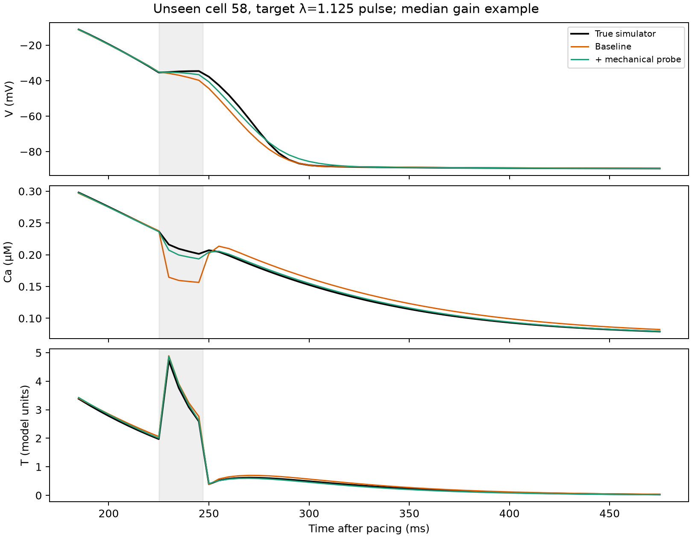
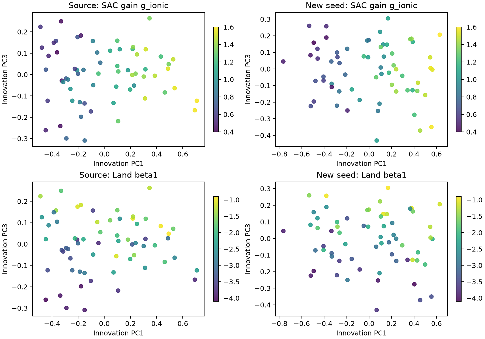
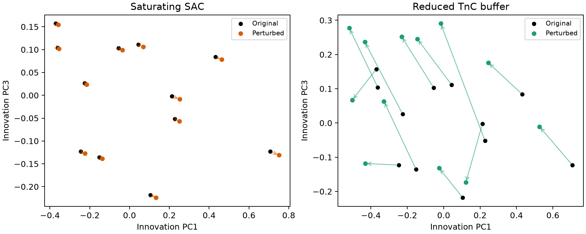

# 力电闭环是否需继续修改，以及完整轨迹功能空间的首轮结果

日期：2026-10-18。对象是现有 **ToR-ORd/SAC–Land** 人心肌虚拟细胞。此报告区分两种边界：既有 50 状态队列使用**实验者指定的长度脉冲**，AP/Ca/T 之间存在双向反馈；近期 51 状态原型由外力与主动张力**内生求出一维长度**，但尚未生成足够多的配对细胞队列。以下空间检验使用前者，不把结果误称为已验证的外力→二维形变→电闭环。

## 先做出的工程判断

**现在冻结已有方程开展轨迹空间研究。** 51 状态原型的严格与默认求解器电压 MAE 为 0.000278 mV、Ca MAE 1.44×10⁻⁶ µM、长度 MAE 8.53×10⁻⁷，已足以排除眼前的数值误差疑问。继续增加 SAC/TnC 或神经残差项不会替代缺失的边界条件和机械校准。目前弹性 K、黏性 η、二维几何及外载尚未由同一细胞同步 AP/Ca/位移/力识别；六个公开肌节细胞也没有配对 AP/Ca 和受控急性拉伸，形变 MLP 留细胞测试没有超过 ridge。因此**要进一步做的是验证和校准机械体，而不是立刻扩展反馈方程或扩大形变网络**。

## 完整轨迹空间实验

脚本 `full_trajectory_space_gate.py`，输出 `full_trajectory_space_gate.json`。源队列 64 个虚拟细胞、另一随机种子确认队列 64 个；两批同一方程与参数范围。每细胞有 13 个固定参数，及 8 种长度协议的 V/Ca/T 1 ms 轨迹。本分析每 5 ms 采样：基线取 300 ms 挑战发生前的轨迹，校准挑战取 300–600 ms，未来取 3 个目标协议各自刺激前 40 ms 至刺激后 250 ms 的 **V/Ca/T 完整轨迹**。按源队列预定尺度 1 mV、0.01 µM、0.5 张力模型单位及各协议/模态等权；单位化 L2 距离**不是**物理 MAE。

源队列设定所有归一化、PCA、线性回归及正则选择；确认队列按细胞整体留出。未来三个协议在源细胞中可作为监督标签，因此这里是**留细胞预测，不是留整个协议族外推**。确认队列先前已用于概要特征研究，也不是全新未接触的最终封存试验。

## 1. 机械挑战是否重排完整轨迹的功能邻域？

| 检验 | 仅基线 | 加 300 ms 机械挑战 | 解释 |
|---|---:|---:|---|
| 确认队列内五近邻的未来全轨迹距离 | 2.167 | 2.139 | 小改善；按细胞 bootstrap 的改善区间 0.004–0.057；打乱挑战与细胞的对应关系时单侧经验 p≈0.016。 |
| 源细胞最近邻均值预测确认细胞 | 1.540 | 1.546 | 未改善，机械信息不等于简单邻居检索自动受益。 |
| 源细胞选择正则强度的多输出 ridge | 0.985 | **0.358** | 按细胞 bootstrap 的差值区间 0.538–0.721；64/64 个确认细胞改善。 |
| 把基线观测复制一份后重训 ridge | 0.988 | — | 单纯增加输入维度/改变特征权重不能解释挑战模型的增益。 |

固定正则 10 时 ridge 为 1.000→0.723，方向相同。只在源队列五折选正则后，基线选 1.0、挑战选 0.1，得到上述更强的 0.985→0.358。未来轨迹转回物理单位后，源训练 ridge 的确认队列平均误差：V **0.597→0.224 mV**，Ca **0.00236→0.000415 µM**，T **0.0263→0.0154 模型单位**。这些误差小，部分因为未来协议和生成方程均与训练群体共享；不构成真实人心肌预测精度。

把未来每段轨迹先去时间均值、再按带物理下限的时间尺度归一，固定正则 ridge 仍从 0.0935 降到 0.0741。这说明增益不完全由整体偏移/峰值尺度造成；由于下限存在，此检验**不是严格去除幅度**的纯形状分析。

图示为按照所有确认细胞预测增益中位数选出的个体，黑线是真方程，橙线仅基线预测，绿线加入短机械挑战后预测；灰区是封存协议的 20 ms 拉伸。示例仅辅助观察，统计结果按全部 64 细胞计算。

## 2. 轨迹空间是分群，还是连续的机制方向？

原始基线+挑战轨迹的前五个 PCA 坐标，源队列单高斯 BIC 为 **1390.6**，2 成分 **1419.5**；挑战新增部分在扣除由基线线性可预测的延续后，单高斯 BIC **−338.2**，2 成分 **−270.1**。确认队列的密度分数对两种选择差异很小，有时微弱偏向 2 成分。因此目前**没有可重复的离散状态证据**；混合高斯也无法证明数学上的连通性或内在维数。连续抽样的合成先验、小样本和强低秩波形都限制这个判断。

原始完整轨迹主要由基础 AP/Ca 生理变化主导：第 2 轴与 IKr 的 Spearman 相关为源队列 **−0.749**、确认 **−0.668**。为分离机械挑战增加的信息，只用源细胞训练“基线轨迹→挑战期间正常延续”的线性模型，然后对剩余轨迹拟合源队列 PCA；这是**挑战创新坐标**，不是纯粹的生物物理机制变量。

在该冻结坐标中：

- PC1 与 **SAC gain `g_ionic`** 的相关为源 **0.898**、确认 **0.920**；
- PC3 与 **Land β1** 的相关为源 **0.633**、确认 **0.651**。β1 也部分进入 PC2，因此不能说一个参数对应唯一轴。
- 仅用基线轨迹得到的 g_ionic/β1 相关不能稳定跨批次复制，符合在 λ=1 时缺少相应机械激发的预期。

这是一种**同方程内部的参数—观测梯度**。两个已知参数都在模拟器中定义，参数又按连续 Latin-hypercube 抽样；观察到连续梯度本身不是新生理发现。它给后续异方程和实测验证提供了明确的待证伪坐标。

## 3. 将已知模型形式扰动投到冻结空间

对 12 个源细胞，分别取同一细胞改为饱和型 SAC、减弱 TnC 缓冲后的 300 ms 校准轨迹，不重拟坐标。前五坐标中的配对位移范数中位数分别是 **0.0227** 和 **0.299**。饱和型 SAC 在本 1.10、10 ms 短校准下只发生细小位移；TnC 形式改变有大得多的多轴位移。两种扰动的参数改变量和物理单位不同，**不能据此说 TnC 生物作用比 SAC 强**。这反而提示：一个在原方程中很漂亮的梯度，换反馈形式后可能产生横向漂移；解释空间之前必须评估模型形式的不确定性。

## 下一关

现有第二套 **ORd–MechChem** 数据其实也保存了完整 V/Ca/T 轨迹。因此另做了 `mechchem_static_trajectory_gate.py`：19 个四负荷都合格的细胞，用静态 λ=1.00 的全轨迹找三个近邻，未来 λ=1.075/1.10 的轨迹距离为 **0.5131**；加入 λ=1.05 后为 **0.5087**。19 个细胞中只有 **2 个**近邻改善，其余没有重排，细胞重抽样改善区间 **0–0.0132**。挑战打乱的置换检验 p≈0.001，说明那两个改变并非随机对应，但不能掩盖总体效应微弱和小样本。独立模型使用**静态预负荷且无直接 SAC**，无法直接检验原模型 300 ms 短脉冲的五维坐标；它目前只支持更窄的判断：轨迹层面的挑战增益也有明显模型/协议依赖。分数在 `mechchem_static_trajectory_gate.json`。

眼前无需再调网络或反馈项。最直接的强检验是：为**外力驱动、内生长度**的 51 状态闭环生成一个小型同参数多负载队列，同时记录 V/Ca/T/λ；将上面冻结的功能邻域与创新坐标投过去，并设不含 SAC、不同黏弹律和异方程真值的对照。若坐标仅在指定 λ 的 50 状态队列中成立，它应保留为该模型的可观测性工具；若跨加载边界和反馈形式仍保留，才开始讨论可转移的“力电轨迹空间”。真实同步形变和电/Ca 数据仍是生物学验证的必要环节。
