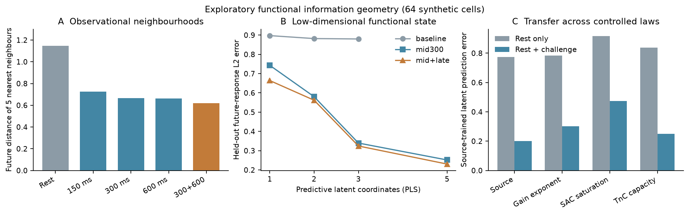

# 机械干预与功能信息空间：64 个虚拟细胞的去留测试

日期：2026-10-02。研究问题：**不要求恢复全部 13 个生理参数时，一次机械挑战是否形成足以预测未来响应的低维功能表征？** 前半部分是既有 64 细胞队列的探索性检验；文末使用全新随机种子的 64 细胞队列复核冻结规则。两批仍来自同一套方程，均非真实心肌细胞。

## 冻结的定义

- 静息观测：每细胞的 APD、Ca 峰、张力峰，共 3 项。
- 候选机械挑战：五种既有长度脉冲。每种取 12 项 AP/Ca/张力响应特征；主要比较 150、300、600 ms 的 λ=1.10 脉冲。
- 未来功能：三个既有目标机械协议，每个 6 项输出，共 18 项。包括相位/幅度区间内目标、更大幅度加更长保持、及较晚相位目标。
- 观测空间按**源队列**的各特征跨细胞标准差缩放，静息和每种挑战作为等权块；低于预定物理分辨下限的特征不用。未来距离按各目标等权并取标准化欧氏距离。
- 邻居数固定为 5；潜在维度预先检查 1、2、3、5（PCA 另查 8、13）；模型选择不依赖可视化。

代码：[分析](functional_information_geometry.py)、[绘图](plot_functional_information_geometry.py)；全部结果与参数：[JSON](human_bidirectional_output/feedback_functional_information_geometry.json)。

## 1. 静息相近，未来未必相近

仅用静息观测寻找每个细胞的 5 个最近邻，这些邻居在未来协议中的平均功能距离为 **1.147**。用“静息 + 300 ms 机械挑战”重新寻找邻居，降到 **0.666**，每细胞配对改善 0.481，bootstrap 95% 区间 **0.404–0.561**。把挑战记录在细胞间随机打乱 1,000 次，没有重现该改善（单侧置换 `p≈0.001`，即当前置换次数的分辨下限）。

在静息距离最近的 10% 细胞对中（202 对），静息距离和未来距离的 Spearman 相关仅 **0.067**；加入机械挑战后的观测距离和未来距离相关为 **0.899**。这些细胞对共用细胞，不能把 202 对当 202 个独立生物学重复，也不能给该相关值直接附普通独立样本显著性检验。最近邻数改成 3 或 10，改善分别为 **0.566** 或 **0.427**，方向相同。结果说明：在本模型的这组观测尺度下，机械挑战显著重新排序了邻居，使其更接近未来功能关系。

伸展反馈幂指数改变的 64 细胞替代真值中，静息邻居未来距离为 **1.096**，300 ms 挑战后 **0.648**，改善区间 **0.374–0.523**。这支持现象对这一项受控失配有一定稳定性；仍非独立人心肌模型验证。

## 2. 功能预测需要多少坐标？

在 5 折**按细胞留出**验证中，每折只用训练细胞拟合特征缩放、PCA/PLS 和预测器；测试细胞的未来响应仅评分使用。下列误差是未来 18 项输出的标准化 L2 距离，越低越好：

| 观测 | 预测表征 | 5 折误差 |
|---|---|---:|
| 仅静息 | 3 维 PLS | 0.880 |
| 静息 + 300 ms 挑战 | 3 维 PLS | 0.340 |
| 静息 + 300 ms 挑战 | **5 维 PLS** | **0.252** |
| 静息 + 300 ms 挑战 | 全部观测特征 + 固定 RBF | 0.247 |
| 静息 + 300/600 ms 挑战 | 5 维 PLS | **0.230** |

20 组不同的 5 折随机划分中，3 维静息 PLS 平均 **0.867**（范围 0.838–0.904），5 维单挑战 PLS 平均 **0.247**（0.238–0.258），5 维双挑战 PLS 平均 **0.224**（0.213–0.231）。这些划分反复使用同一批 64 个细胞，表示**划分敏感性**，不是 20 个独立确认实验。

因此当前可说：在此合成队列内，**5 个监督式功能坐标基本保留了完整挑战特征对已定义未来任务的预测能力**。2–3 维尚不足以达到相同准确度；5 维也不是机制状态变量的唯一分解。未来响应本身的 PCA 前 3 项累计解释约 92.9% 方差，但平滑、相关的脉冲输出也天然容易低秩，不能仅凭这点宣称发现五个或三个生物学状态。PLS 坐标是**针对这三个未来任务优化的统计坐标**，不是与未来任务无关的通用细胞状态。

作为参考，若把 13 个**真实**参数交给一个只有 64 样本可训练的固定 RBF 映射，5 折误差为 **0.309**；这反映有限样本机器学习映射的误差，不意味着真实参数不重要。把精确 13 参数送入生成它们的原方程，理论上仍可精确重现同模型未来输出。我们展示的是：**不必先把所有参数唯一反演出来，也能建立有用的功能预测表征**；尚未证明该表征取代机制模型。

**关键协议可见性限制**：PLS 和 RBF 训练时使用了**训练细胞**在三个未来目标协议下的输出；测试细胞完全留出。因此这一节证明的是“未见细胞的功能预测”，不是“整种未来协议对群体学习器从未出现”的外推。整协议留出的测试仍以[前一轮报告](human_feedback_three_chains_report.md)为准。

## 3. 不同机械协议提供多少互补信息？

单独的 300 和 600 ms 挑战让未来邻居距离分别为 **0.666**、**0.662**；二者联合为 **0.620**。相对每个细胞更好的单协议，联合平均再降低 **0.016**。5 维预测坐标也由单 300 ms 的约 **0.247** 降到 300+600 ms 的约 **0.224**。只看这些数字，容易误以为存在协议互补。

关键零假设是：**把同一个协议观测复制两遍**，使机械特征块数与双协议相同，但没有提供新信息。与每个细胞更好的“重复单协议”相比，300+600 ms 的联合邻居表现反而差 **0.017**（改善的 95% bootstrap 区间 **−0.026 至 −0.009**）；150+600 ms 的联合优势仅 **0.004**（**−0.007 至 0.014**，跨零）。因此原先的小幅改善主要可以由机械观测权重增加解释，**尚无独特互补信息的可靠证据**。本轮**不建立 hypergraph，不宣称 intervention-induced information topology**。

## 4. 功能坐标跨方程能否迁移？

在固定的 52/12 细胞划分上，只用源方程训练 5 维 PLS，再预测不同真值方程中的同一 12 个测试参数个体：

| 测试真值 | 静息 3 维 | 300 ms 挑战 5 维 |
|---|---:|---:|
| 源方程 | 0.773 | **0.200** |
| 伸展增益幂指数改变 | 0.784 | **0.302** |
| 饱和式 SAC 输入 | 0.918 | **0.475** |
| TnC 缓冲容量 75% | 0.837 | **0.251** |

挑战观测的价值在四种真值里都保留了，但饱和式 SAC 导致 5 维表征误差从 0.200 增至 0.475，不能称为“跨模型鲁棒”。后两组只有 12 个测试细胞，且均为**同一整体模型框架中的替代方程**，不是独立发表模型的外部真值。

## 去留判定

## 5. 全新随机种子队列的冻结规则复核

在上面规则全部确定后，使用新的参数抽样种子 `20261002`，独立生成并预起搏 **64/64 个成功的新虚拟细胞**。保留原队列的各特征尺度、5 个邻居、300 ms 协议、PLS 维数与模型系数；新细胞的未来协议结果只在最后评分时使用。生成代码仍是[13 参数队列生成器](human_feedback_13param_cohort.m)，输出文件为 `feedback_13param_confirm_cohort.*`；冻结复核代码：[确认脚本](confirm_functional_information_geometry.py)、[分数](human_bidirectional_output/feedback_functional_information_confirmation.json)。

| 新队列指标 | 静息 | 300 ms 挑战 | 300+600 ms |
|---|---:|---:|---:|
| 5 近邻的未来功能距离 | 1.221 | **0.641** | 0.582 |
| 原队列训练的 PLS 未来预测误差 | 0.848（3 维） | **0.188（5 维）** | 0.179（5 维） |
| 原队列训练的全部观测 RBF 误差 | 0.897 | 0.157 | 0.140 |

邻居改善为 **0.580**，按新细胞重抽样的 95% 区间 **0.509–0.652**；1,000 次打乱新细胞的挑战记录未复现改善（置换 `p≈0.001`）。因此原队列的核心邻居现象在**新抽样、同方程**队列中复现。5 维状态在新队列仍有效，但比全部观测的 RBF 误差 **0.157** 高约 20%；不能说 5 维是无损的最小状态。

双协议相对更好的单协议邻居距离额外降低 0.026，但与“复制两份更好的单协议”比较，净增益为 **−0.008**，区间 **−0.017 至 −0.0003**。新队列再次支持“更多机械特征权重”足以解释简单双协议优势，**不支持不可约高阶协同**。这批新细胞仍共享原有方程、同样的参数范围和目标协议，不是跨模型或真实人源验证。

**GO：继续研究任务相关的低维功能状态**，因为邻居关系改善有具体未来任务支撑，细胞打乱检验未复现，在全新同方程队列中复现，而且 5 维预测表征在若干受控失配下仍优于静息观测。

**NO-GO：现在就把项目命名为“信息拓扑”或引入高阶网络。** 重复单协议对照在两批同方程细胞中都否定了明显的双协议独特收益。真正不同的人心肌闭环模型作外部真值，以及真实人源机械挑战数据，仍是下一等级的证据门槛。
