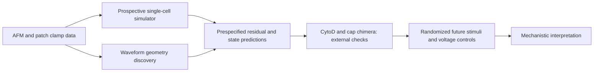

# 力电仿真器、波形几何与扰动验证：统一研究路线

日期：2026-09-26。本路线结合现有 Duke AFM–电压钳结果、单细胞力电仿真器设计、Sebastian 等 2023 年的波形拓扑分析。它是一份待检验的研究方案，不把低维嵌入或概念电路本身当成机制证据。

## 主问题与证据链

**问题：**同一细胞受不同机械刺激时，个体阈值、刺激强度和时间动力学如何共同决定电流？在控制输入、细胞和实验日期后，电流波形是否仍有可复现的结构；该结构能否由独立扰动检验？

现有模型给出清晰起点：首次响应提供个体阈值；瞬时 AFM 力代理较好定位 Piezo2 的峰值时刻；Piezo2 的跨 sweep 峰值幅度由力幂律比线性比例预测得更好，Piezo1 非线性增益尚不稳；简单共享适应 ODE 没有稳定改善绝对电流波形。仿真器当前只应承诺**给定机械轨迹和电压钳条件下的可检验电流预测**，不可把 AFM 力直接写成膜张力，也不可由固定电压下的电流唯一反演 `Popen`、`Gmax` 或自由膜电位。

## Sebastian 论文可迁移的逻辑及规模差异

Sebastian 等将 10,741 个 ripple 波形（58 次独立 session、27 只鼠）映射到原始 127 维时间采样空间。论文先在合成波形/拓扑对象上检验 persistent homology 和内禀维数，再在真实波形上报告连续的点云及估计的约四维结构；生理解释来自独立的层特异电流源密度、神经活动及光遗传诱发实验。该论文的强项是“波形结构→独立生理量→扰动”，不能直接把它的四维数值移植到 Piezo。[用户提供的 Sebastian 等 2023 年论文，图 2、4、5 及方法。]

本地 Duke `bychannel_summary.csv` 的 WT Piezo 原始队列是 Piezo1 **23 个细胞**、Piezo2 **13 个细胞**；现有一次校准且有同电压未来 sweep 的严格预测队列是 11/13 个细胞、32/28 个未来 sweep。即使每细胞有多条 sweep，**独立生物学单位仍主要是细胞，且日期更少**。因此目前可以做波形几何的可行性研究，不能仅凭一个 UMAP 图或一次 persistent homology barcode 宣称存在若干“真实通道状态”。

特别要避免把 `intrinsic dimension ≈ 2–4` 解释成 ODE 里恰好有 2–4 个生物物理状态。波形点云维度还包含刺激强度、阈值、细胞参数、对齐方式、电压、噪声和批次；反过来，多个机制状态也可能在现有观测下投影到同一方向。**内禀维数是观测分布的性质，不自动等于隐藏状态数。** Persistent homology 的一个连通分量也仅说明在该尺度下点云连续，不说明只有一种细胞状态。

## 波形几何分析的预设流程

1. **冻结输入与单位。** 沿用当前 1 kHz、接触点和接触前基线规则。优先分析同一持有电压下的**带符号诱发电流**；现有绝对值电流可作为既有结果的敏感性版本。若原始符号、极性或钳制质量不一致，先审计再合并。电流窗同时保存接触对齐和 AFM 力峰对齐版本；不以测试电流峰对齐主分析，否则会抹掉待研究的响应延迟。
2. **把三个效应拆开。** 同时建立原幅度波形、按**本 sweep 真实峰值**归一化的*描述性形状空间*，以及从训练数据可预测峰值归一化的*前瞻空间*。真实峰值归一化只能用于生理形状探索，不能偷偷用于未来波形预测。每个空间分别记录机械峰值、功、阈值、持有电压、细胞、日期及重复 sweep。
3. **从简单几何开始。** 先用成对波形距离、PCA/函数型 PCA 和几个预定特征（onset、力峰到电峰延迟、峰后 20/50 ms 保留比例、表观 decay、幅度）确定结构是否超过幅度与平移伪影。再在原始波形距离上估计内禀维数及重采样稳定性；UMAP 只作可视化并检验邻域与超参数稳定性。Persistent homology 仅在细胞数、密度和稳定性足够时研究 H0/H1，并与匹配噪声、对齐随机化、幅度/延迟保留的合成波形作对照；不预设必须找到环或离散簇。
4. **以细胞和日期为统计单位。** 重复 sweep 可刻画细胞内轨迹，却不能当作独立样本增加显著性。特征关联用按细胞聚合、细胞重采样和整日期留出；学习的标准化、PCA/UMAP、邻域、分类边界都只在训练日期拟合，再投影测试日期。报告每个结论对时间窗、对齐、幅度归一化、噪声水平和细胞等权抽样的稳定性。
5. **联系仿真器残差。** 比较实测波形、仿真器预测及残差的几何。如果某个稳定方向仅由输入幅度或细胞增益驱动，应先修正观测/幅度模块；只有在控制这些因素后仍存在跨细胞可复现的时间形状方向，才有理由增加机械滤波或通道适应状态。新增状态必须提升未见日期波形预测，而非只复刻 UMAP 图形。

## 扰动数据能检验什么

**Chimera：**本地 `chimera_experiments` 有 11 个 chimA 原始 Feather 细胞，分布在 2020-11-08/10；WT Piezo1/2 原始细胞主要来自更早的不同日期。已有 summary 中 chimA 的峰值延迟与阈值更接近 Piezo2，但若波形嵌入也出现“更像 Piezo2”，仍需排除整批日期、刺激强度与细胞选择造成的偏移。将 WT 参考空间、距离尺度和比较指标**先冻结**后投影 chimA，只能作为外部一致性检查；现有数据不能完成同日 WT 对照的强因果检验。`chimB` 分子定义未从当前 README 审计中确证，暂不赋机制标签。

**CytoD：**本地 Piezo2 同日对照/处理数据支持阈值变化方向的探索，但无响应细胞的含义会显著改变阈值估计。对几何迁移应同时报告响应概率、峰值、刺激强度、细胞/日期分层及处理条件；若只选有响应的波形进入点云，会引入选择偏差。不能将任一嵌入轴预先命名为骨架力传递参数。两类扰动均不参与 WT 几何/模型超参数选择。

## 如果能补做一组前瞻实验

在同一细胞内、固定持有电压与探针几何下，**随机化加载速度与刺激强度的顺序**，并记录实际 `F(t)`、压入代理、保持段、释放段和完整电流；设置重复的参考刺激监测漂移/损伤，并记录刺激前漏电、膜电容和串联电阻。设计若能产生近似相同峰值力而不同加载速率/保持时间的轨迹，就能检验时间形状究竟由瞬时力、力变化率、机械松弛还是适应过程驱动。另用间隔随机化的成对刺激辨认恢复，不从现有固定约 5 s 间隔数据反演恢复常数。多持有电压/反转电位测量可检验“受控电流源”是否有资格升级为机械控制电导模型。各条件在细胞内交错、日期内平衡，分析单位仍为细胞/日期。

## 决策门槛

| 阶段 | 需要看到的结果 | 若达不到则保留的结论 |
| --- | --- | --- |
| 前瞻幅度与时序模型 | 整日期留出在峰值、onset、postpeak 和误报上分别有稳定增益 | 个体阈值与 Piezo2 幅度外推有效；完整波形动力学未解决 |
| 波形几何 | 多种对齐/归一化、细胞等权抽样与日期留出下仍有稳定结构，且不是幅度/噪声伪影 | PCA/特征图只作描述，不声称“拓扑状态” |
| 生理解释 | 控制机械输入、电压及日期后，波形方向仍关联独立的机械/电生理量 | 关联仍为相关，不赋机制参数名 |
| 扰动验证 | 冻结 WT 分析后，CytoD/chimA 迁移符合预先提出的特异预测，并有合适对照 | 作为方向一致的探索性外部检查 |
| 更完整的机制电路 | 新实验区分机械滤波、通道适应和电驱动力，并改善独立数据预测 | 保留观测级电压钳仿真器，不宣称唯一物理机制 |

这条路线适合形成 **预测—表征—机制检验** 的完整论文结构；目前应把 TDA 视为严格受控的发现环节。论文层级取决于独立预测、可复现几何和扰动证据共同成立，而不是方法名称或软件规模。

2026-09-26 的首轮实施结果见 `simulator_geometry_progress.md`：幅度与形状模块联合后仍未稳定改善完整波形；WT 波形的描述性 PCA 主方向受幅度、SNR 和对齐方式影响，因此暂不把主成分数或 persistent homology 当作隐藏状态数。
