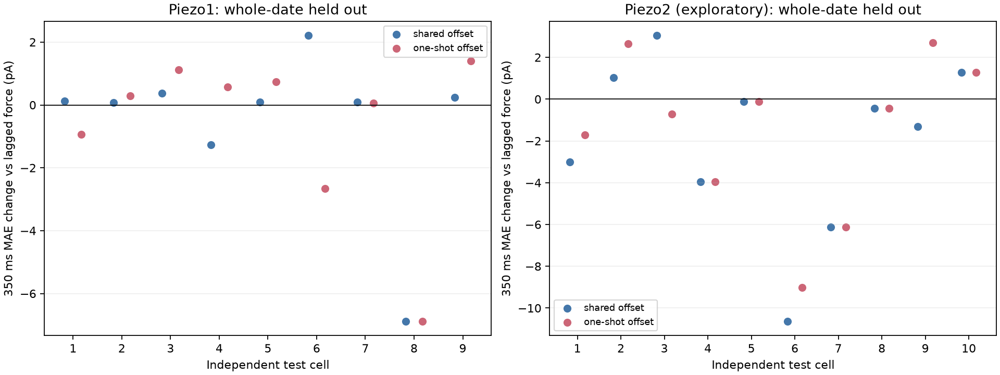

# ETH→eLife→Duke 张力门控仿真器：首次严格留出检验

**更新（2026-09-27）：** 本文保留为初版模型的失败审计。下文出现的 Duke `T0` 是当时网格的有效偏置标签，不能解释为真实细胞预张力，也不再作为当前报告参数。后续分析已改用力域 `F50_eff,sF_eff`，见 [1→2→3-shot 预测与 profile 审计](effective_force_kshot_report.md)。

日期：2026-09-27。问题是：独立实验约束的 `外部 AFM 力→局部机械状态→Piezo1 sigmoid 门控`，能否比已验证的简单力模型更好地预测未见日期细胞的未来电流？**结果：目前没有检出 Piezo1 的额外预测收益；细胞预张力参数未被本次 one-shot 数据识别。** 这不否认预张力的生物学作用，而是限定当前数据对它的可辨识性。

## 数据模块与物理含义

三个来源只约束各自模块，没有合并为同一种细胞记录：

- ETH HFF-1/FluidFM Stepwise 的局部张力变化给 `αF≈0.00698 mN/m/nN`；该值仅是 Duke 力传递的量级参考。[Stepwise 同细胞分析](eth_stepwise_report.md)；[ETH 原论文](https://www.nature.com/articles/s41592-024-02277-8)。
- eLife Neuro2A cell-attached **Piezo1** patch 的 25 个测量给 `T50` 中位 **2.487 mN/m**、斜率 `k` 中位 **0.681 mN/m**，作为固定 Piezo1 sigmoid 参数。[eLife Figure 5 与源数据](https://elifesciences.org/articles/70988/figures)。
- Duke HEK293T AFM+电压钳只检验预测：既有冻结的 −80±5 mV 带符号、刺激前 QC 队列，Piezo1 **9 个细胞/20 条未来 sweep/6 个日期**，Piezo2 **10/23/3**。每个测试细胞只允许首次可用响应作校准；未来电流只用于最终评分。Piezo2 因没有对应的 eLife Piezo2 张力门控先验，以下只作**借用 Piezo1 曲线的探索性转移**，不能解释为 Piezo2 真实 `T50/k`。

在首次响应检测力 `Fth,i` 以上，使用

`q_i(F) = [σ((T0 + λF - T50)/k) - σ((T0 + λFth,i - T50)/k)]_+`

和 `Î_i(t) = Ical,peak × q_i(F(t))/q_i(Fcal,peak)`。减去 `Fth` 处的 sigmoid 值是电流检测阈值/基线的**操作性处理**，不能将该点解释成已测得的单通道 `Popen`。在单一保持电压下，比例中的增益、最大通道数、单通道电导和 `V−Erev` 也无法分别估计。

第一版让 `T0` 在 0–2.5 mN/m 网格上作为**共享有效偏置**，`λ=αF×{0.25,0.5,1,2,4}`。每个整日期留出折只用其他日期的未来 sweep，以**每细胞等权的峰值 `log1p` 绝对误差**选择这两个共享超参数。测试细胞的 `Ical,peak`、`Fth` 来自首次校准，测试 sweep 只提供自己的 AFM 力轨迹。这个设计没有从一次峰值强行声称同时估出 `T0,i,λi,Gi`。

随后做两项严格区分：

1. 加入 [Young 等原论文](https://pmc.ncbi.nlm.nih.gov/articles/PMC9974467/)报告量级的固定时延，Piezo1 **8 ms**、Piezo2 **1 ms**；给张力 sigmoid **和简单线性力**完全相同的时延对照。原论文组均值约 8.2 ms 与 1.5 ms；固定时延只是通道级近似。
2. 尝试仅用测试细胞首次响应的**上升段形状**，在共享 `λ` 下选择该细胞 `T0,i`（0–2.5、步长 0.25 mN/m），再预测其未来 sweep。整个选择不看未来电流。

## 结果：已知时延有用，sigmoid 和个体 T0 尚未显示增益

下表是 Piezo1 严格留出结果。`MAE 中位数`为每细胞先平均未来 sweep，再取 9 个细胞中位数；**判断增益应看同细胞配对差**，不能相减不同模型的中位数。

| 模型 | 350 ms MAE 独立中位数 | 相对同样延迟的线性力：配对 MAE 中位差 | 改善细胞 | 峰时误差中位数 |
| --- | ---: | ---: | ---: | ---: |
| 无延迟的阈值力 | 104.67 pA | — | — | 11 ms |
| 无延迟的张力 sigmoid | 104.87 pA | — | — | 11 ms |
| **固定 8 ms 延迟的阈值力** | **74.16 pA** | 参照 | — | **5 ms** |
| 固定 8 ms 延迟的张力 sigmoid、共享 `T0` | 76.37 pA | **+0.09 pA** | 2/9 | 5 ms |
| 固定 8 ms 延迟的张力 sigmoid、one-shot 形状拟合 `T0,i` | 71.51 pA | **+0.29 pA** | 3/9 | 5 ms |

峰后 0–50 ms MAE 的同细胞配对变化相对延迟线性力分别为 **+0.14 pA** 和 **+1.0 pA**；峰值绝对误差的配对变化为 **+0.59 pA** 和 **+4.44 pA**。这里正数为变差。one-shot `T0,i` 模型自己的 MAE 中位数看起来较低，但**同细胞配对比较没有改善**。同样，峰时误差从 11→5 ms 完全由给两个模型都加了相同的固定延迟解释，不是 sigmoid 证明了一个新的张力动力学。

共享 `T0` 在 Piezo1 **全部 6 个留出日期折选到 0 下界**；在 one-shot 上升段拟合中，**7/9 个 Piezo1 细胞选到 2.5 上界**。多数细胞的整个 0–2.5 网格在归一化上升段 MAE 上相差不到 0.02，Piezo1 单细胞损失全网格跨度中位仅 **0.00154**。这种边界相反、目标函数近乎平坦的结果是**参数不可辨识**的信号，不能把拟合出的 0 或 2.5 mN/m 当作真实基线膜张力。更基本地，单个校准峰值对任意候选 `T0,λ` 都可调整电流尺度精确匹配，故不可能从一个峰值唯一恢复三者。

把 eLife `T50/k` 改为四分位低/高的四种预设组合后，Piezo1 张力模型的细胞中位全窗 MAE 为 **75.4–78.6 pA**，共享 `T0` 几乎仍都选到下界；相对同延迟线性力的配对 MAE 中位差约 **−0.04 至 +0.50 pA**、仅 2–5/9 细胞改善。结论不由单一中位 patch 参数决定。这些四分位组合只是先验敏感性范围，不是新的测试集调参。

作为模型复杂度参照，Piezo1 张力模型加延迟相对三个固定初始化 CNN 的逐细胞配对全窗 MAE 中位数约低 **4–13 pA**；**同延迟的简单线性力**也低约 **4–7 pA**。因此这不能归功于 ETH/eLife sigmoid，也不足以声称完成了更准确的 mechanistic forward simulator。[先前 CNN 审计](sequence_benchmark_report.md)。

Piezo2 借用 Piezo1 门控曲线的探索性检验中，同延迟 sigmoid 相对同延迟力模型配对全窗 MAE **−0.88 pA（7/10 细胞改善）**、峰值误差 **−28.8 pA（7/10）**；one-shot `T0,i` 再拟合没有额外稳定收益。这只能提示非线性幅度形状仍值得研究，**不能给 Piezo2 的 `T50`、预张力或门控机制赋值**。

## 科学结论与下一步

三套外部数据确实使 `F→ΔT→Popen` 架构有物理量纲和独立约束；ETH 内部的 FLIM→Ca 阈值交叉检验也成立。但迁移到 Duke 的第一版 **静态** sigmoid 在 Piezo1 未来 sweep 上尚未超过公平的相同时延线性力模型，`T0,i/λi/Gi` 也不能从一次校准稳定拆开。失败可能来自外部几何转换、细胞预张力未观测、局部受力面积/通道数、时间动力学或它们的组合；当前结果不能在这些原因中选择唯一解释。

下一步需要**额外独立约束**：例如在同一细胞测至少一个额外刺激强度，并在多电压或局部张力测量下固定电流尺度/机械转换的部分参数。若仍只用现有 Duke 数据，更合理的是把 `T0` 和 `λ` 当作**预测等价参数族**做敏感性分析，而不报告单个细胞的物理预张力。完整波形的峰后衰减仍需单独的可观测机械或有效适应过程，静态 sigmoid 无法独自解释。

复现：[共享张力模型](mechanistic_tension_simulator.py)、[one-shot `T0` 审计](mechanistic_tension_personalization.py)、[eLife 先验敏感性](mechanistic_tension_prior_sensitivity.py)、[作图](plot_mechanistic_tension.py)。逐 sweep 结果和参数表：`mechanistic_tension_simulator_scores.csv`、`mechanistic_tension_simulator_fits.csv`、`mechanistic_tension_personalization_scores.csv`、`mechanistic_tension_cell_fits.csv`、`mechanistic_tension_prior_sensitivity_scores.csv`。
