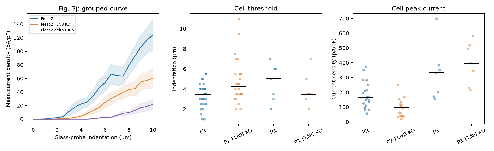

# PIEZO2–FLNB 力传递：Nature 2026 Source Data 审计

日期：2026-09-27。原论文：[Mulhall 等，*The molecular basis of force selectivity by PIEZO2*](https://www.nature.com/articles/s41586-026-10182-7)；公开原始数据入口：[Zenodo 17644763](https://doi.org/10.5281/zenodo.17644763)。本地已下载三份有关的 Source Data：[Fig. 2](/D:/MyProjects/AI细胞/Data/41586_2026_10182_MOESM5_ESM.xlsx)、[Fig. 3](/D:/MyProjects/AI细胞/Data/41586_2026_10182_MOESM6_ESM.xlsx)、[Extended Data Fig. 8](/D:/MyProjects/AI细胞/Data/41586_2026_10182_MOESM11_ESM.xlsx)。只读复算这些工作簿；没有改 Duke 队列和模型。

## 核心功能扰动：FLNB 对 PIEZO2 压入响应有作用

论文在 SWELL1-KO HEK293 背景比较了表达通道的对照细胞和 FLNB-KO 细胞，使用**钝头玻璃探针的压入深度**，并测全细胞电流密度。这与 Duke 的 tipless AFM `nN` 力不是同一个输入量。源表中 `Fig. 3k` 是逐细胞首次响应压入阈值；`Extended Data Fig. 8a` 是逐细胞峰值电流密度。两张表的样本数不同，**不能把同一行当作同一个细胞配对**。

| 通道与终点 | 对照 | FLNB-KO | 本次独立细胞复算 |
| --- | ---: | ---: | --- |
| PIEZO2 压入阈值，组均值 | 3.34 μm，n=29 | 4.71 μm，n=28 | 增加 **1.37 μm**；细胞 bootstrap 95% 区间 **0.52–2.30 μm** |
| PIEZO2 峰值电流密度，组均值 | 183.45 pA/pF，n=19 | 90.19 pA/pF，n=19 | 敲除/对照均值比 **0.492**；bootstrap 95% 区间 **0.340–0.697** |
| PIEZO1 压入阈值，组均值 | 4.64 μm，n=7 | 3.93 μm，n=7 | 均值差 −0.71 μm；区间 **−2.36–1.00 μm** |
| PIEZO1 峰值电流密度，组均值 | 327.43 pA/pF，n=7 | 397.43 pA/pF，n=7 | 敲除/对照均值比 **1.21**；区间 **0.77–1.96** |

这些 bootstrap 区间对**不同组的细胞**分别重抽样 20,000 次，仅是样本不确定性的描述，不能处理细胞培养/实验批次等潜在层级。PIEZO1 两组各 7 个细胞，区间较宽；“未检出显著变化”不能解释为严格证明 FLNB 对 PIEZO1 完全无效。逐细胞点及中位数见下图。

`Fig. 3j` 只给每个压入深度的**组均值、SEM 和该深度的细胞数**，没有完整逐细胞深度—电流曲线。以 6 μm 为例，PIEZO2 对照组均值约 **53.84 pA/pF**（n=24），FLNB-KO 约 **24.74 pA/pF**（n=20）；整条曲线的压入响应也降低。但高深度时各组计数下降，不能把这条平均曲线直接拟合成可转移的单细胞 sigmoid 或把每个深度点当独立细胞。

## CytoD 显示刺激方式会改变结论

`Fig. 2c` 的**渗透性膨胀/膜扩张**实验中，PIEZO2 单独表达组的电流密度中位数约 **−0.60 pA/pF**（n=7），PIEZO2+CytoD 约 **48.24 pA/pF**（n=5）；未转染组约 **0.083 pA/pF**（n=5）。论文将其解释为破坏 actin 连接后，PIEZO2 更容易对膜扩张作出响应。这与上面的 **FLNB-KO 降低压入响应**并不冲突：所施加的形变方向/几何不同，CytoD 是全局骨架扰动，而 FLNB-KO 是特定蛋白扰动。

Duke 的 CytoD 数据使用 AFM 压入和不同细胞/记录协议；因此不能用 Fig. 2c 的膨胀电流比值预测 Duke 的压入阈值。更合理的检验是按**机械刺激方式**分别预先规定响应方向，再检验扰动是否符合。论文也强调 PIEZO2 在 FLNB 连接减弱后可能保留或获得膜张力敏感性，而非“完全不受膜张力作用”。

## 对仿真器的作用与边界

这份独立实验支持把 PIEZO1 与 PIEZO2 的**机械输入层**分开：PIEZO1 可继续以局部膜力学/张力为主要候选；PIEZO2 需要允许 FLNB–actin 耦合对**压入敏感性和阈值**产生影响。上述实验为 PIEZO2 模块提供了一个外部**扰动效应基准**：在该 HEK293/玻璃探针体系中，去除 FLNB 使阈值升高、峰值电流密度约减半。它没有测得“FLNB 耦合常数”，也没有提供从玻璃探针压入深度到 Duke AFM 力的标定，因此不能直接把 **0.492** 当作 Duke `nN→I` 的传递系数。

这份 Nature 数据也没有给 PIEZO2 与 2026 PIEZO1 wedge 论文相同的、可跨实验输入方式移植的恢复动力学参数。论文故事宜表述为“**不同通道与扰动方式提示不同机械耦合路径**”；现在尚不能由这些数据证明所有细胞/所有刺激中不存在统一的高层力电规律。

复现：[只读分析代码](piezo2_flnb_source_data_analysis.py)、[限定实验条件的约束接口](external_mechanics_constraints.py)、[数值与不确定性](piezo2_flnb_results.json)、`piezo2_flnb_cell_values.csv` 和 `piezo2_flnb_indentation_curve.csv`。源码按图表单元格和组别导出，保留来源列号，未与 Duke sweep 合并。
