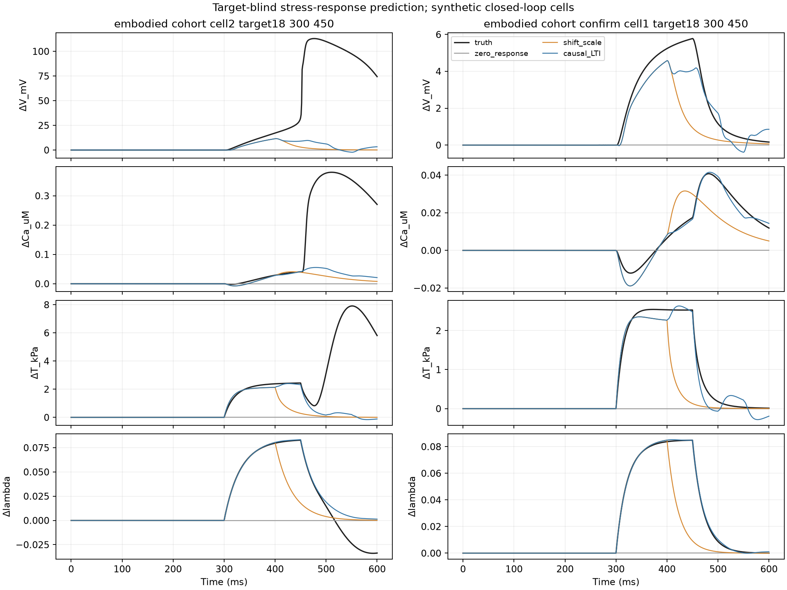
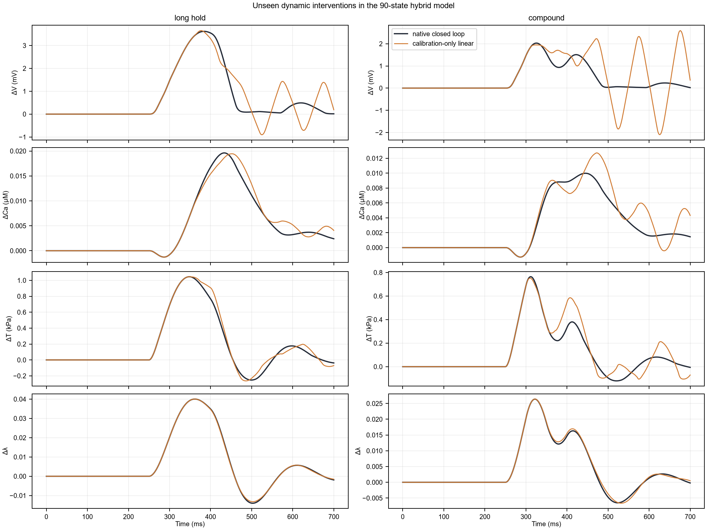

# 力电闭环虚拟细胞：时变干预接口与封存协议轨迹检验

日期：2026-10-19。这里全部是**方程生成的虚拟细胞**；没有把真实显微影像当成同细胞电/钙验证。

## 改动

1. 90 状态 ToR-ORd/SAC–Land × Härtter 逐肌节闭环的 `run()` 现在接受多个 `(prestrain, onset, offset)` 脉冲。相交的脉冲叠加，BDF 在每个负载跳变处准确分段。原单脉冲接口保留。
2. 对已有 51 状态外应力闭环的**两批独立虚拟细胞**建立封存协议评测：每批 12 个细胞。预测只读取同细胞的无载和 12 kPa、250–350 ms 校准轨迹；18 kPa、300–450 ms 及 12 kPa、400–500 ms 轨迹只用于最后评分。每条轨迹包含 V、Ca、张力和内生伸长比 601 个逐毫秒采样点。
3. 预设三个无训练目标数据的对照：预测无响应、平移并按应力幅度缩放一次校准响应、从校准脉冲反演因果单位阶跃响应并对新脉冲做线性叠加。最后一个是有明确假设的**线性时不变响应基线**，不是神经网络，也不是生物真实定律。

## 51 状态队列：强度和持续时间外推

表中为完整 601 ms 波形的电压 MAE（mV）。源、确认队列分开报告，不把 24 个细胞的窗口当成独立样本。

| 封存协议 | 队列 | 无响应 | 平移缩放 | 因果线性叠加 |
|---|---|---:|---:|---:|
| 18 kPa，300–450 ms | 源 12 细胞 | 4.239 | 3.193 | **2.794** |
| 18 kPa，300–450 ms | 确认 12 细胞 | 2.257 | 1.214 | **0.843** |
| 12 kPa，400–500 ms | 源 12 细胞 | 0.842 | **0.161** | **0.161** |
| 12 kPa，400–500 ms | 确认 12 细胞 | 0.839 | **0.158** | **0.158** |

晚相目标与校准脉冲强度、持续时间相同，线性叠加在代数上退化为平移响应，所以二者相等。强度和持续时间都改变时，因果线性基线在**两个**独立队列的 V、Ca、张力、长度平均误差均低于简单平移。确认队列强目标的 Ca/T/λ MAE 为 **0.00157 µM、0.0966 kPa、0.000245**。这说明本任务的大多数响应是简单可预测的；在它上面宣称大网络优势需要先超过这个强基线。

例外同样重要：源队列 2 号细胞在强负载结束后产生了额外电位事件，受载相对无载的最大电压差约 **113 mV**。因果线性基线未预测到；该细胞的 V MAE 为 **25.42 mV**，其余源队列 11 个细胞合计平均约 **0.74 mV**。因此仅报均值或仅展示普通细胞都会误导。40 mV 的事件阈值在本报告中只是描述性计数，不是心律失常诊断，也不是预注册临床终点。



## 90 状态逐肌节闭环：全新时间协议

先用旧的 -5 无量纲预应变、250–350 ms 单脉冲回归检查：改动后的 V/Ca/T/λ 与旧存档的逐点最大差均为 **0**。随后同一名义虚拟细胞分别接受：

- 长持续负载：-5，250–400 ms；
- 两段负载：-5，250–300 ms 和 350–400 ms。

两条目标轨迹**未参与**构建线性预测。其 V/Ca/T/λ 波形 MAE 分别为：长持续负载 **0.295 mV / 0.000650 µM / 0.0253 kPa / 0.000135**；两段负载 **0.524 mV / 0.000949 µM / 0.0436 kPa / 0.000257**。误差主要出现在脉冲停止后的轨迹，尤其两段负载后，线性叠加出现原闭环没有的电压振荡。当前只测试了一个名义细胞，不据此估计群体性能。



## 科学解释与下一道门槛

此检验把问题压缩成两个明确部分：**平滑的机械诱导响应可以由很小的个体校准模型描述；额外电位事件和部分负载后历史轨迹不能由线性叠加保证。** 但事件只在当前 51 状态探索性参数队列中出现一例，无法据此宣称生物学状态分类，也不支持现在训练大型神经网络。

两种闭环模型仍有关键物理边界：51 状态模型的外层刚度和黏性未由同细胞数据校准；90 状态模型的预应变和肌节力是原模型抽象单位，Ca/TnC→运动及肌节长度→伸长比的桥接比例尺是探索性的，Land 张力仍是读数而非统一机械力平衡。两套结果不能混成一个已验证的人心肌效应量。

下一个模型优化应针对**事件风险与长历史**：在开发队列规定事件检测和不确定性评估规则，再用全新细胞及全新协议检验；同时用配对 AP/Ca/力/形变实验约束桥接接口。若没有这些数据，结论应保持在“可运行的、带封存干预基线的计算平台”。

## 复现

```powershell
& .\.venv_tcn\Scripts\python.exe analysis\shape_feedback\blind_closed_loop_benchmark.py
& .\.venv_tcn\Scripts\python.exe analysis\shape_feedback\sarcomere_protocol_suite.py
```

机器可读逐细胞结果：`blind_closed_loop/results.json`；90 状态协议结果和完整局部长度轨迹：`sarcomere_protocol_suite/results.json`、`long_hold.npz`、`compound.npz`。
