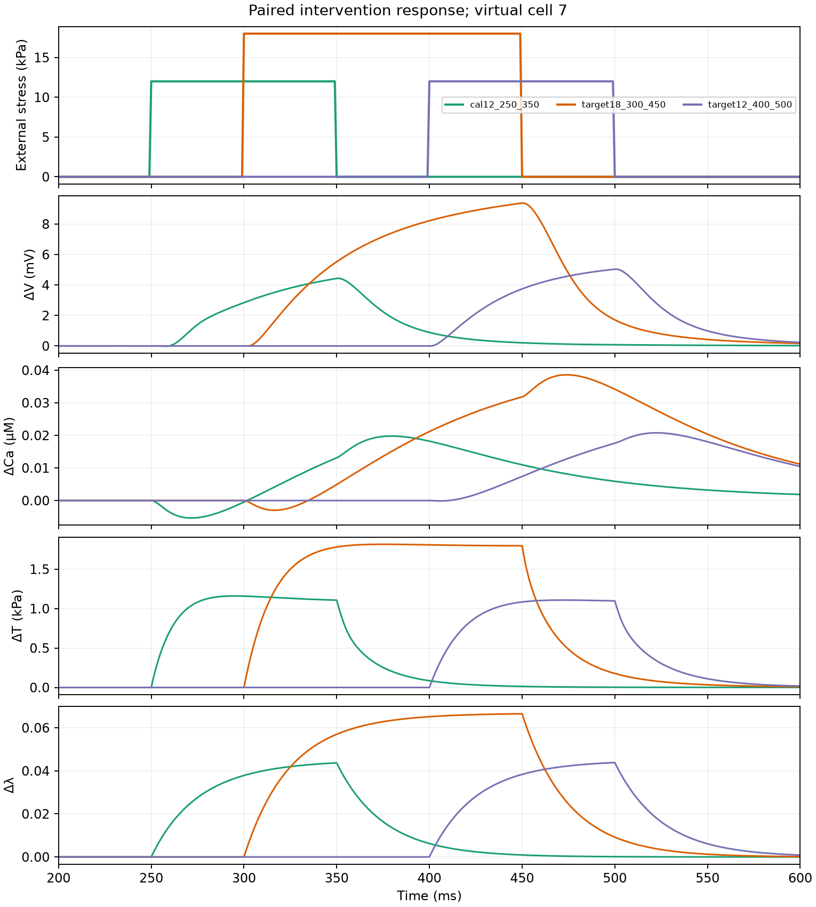
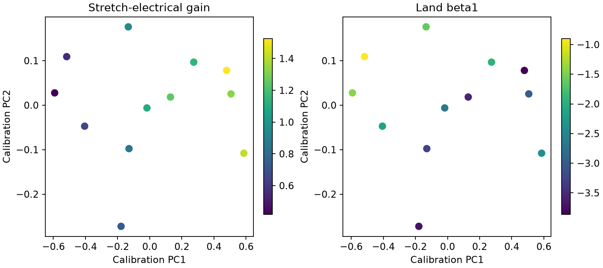
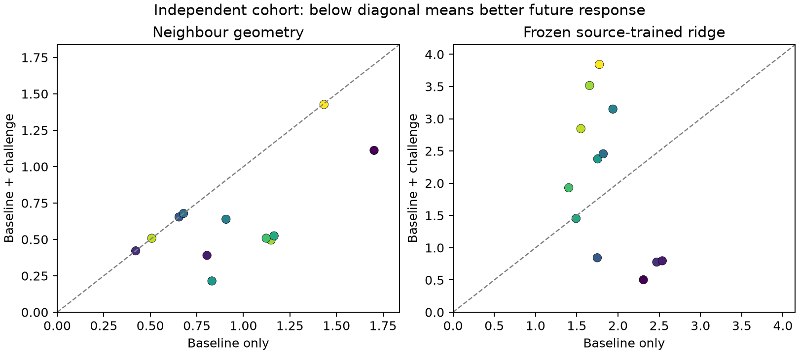
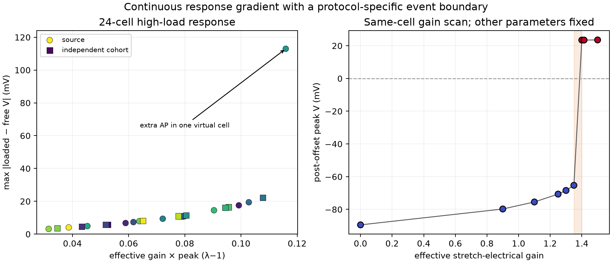
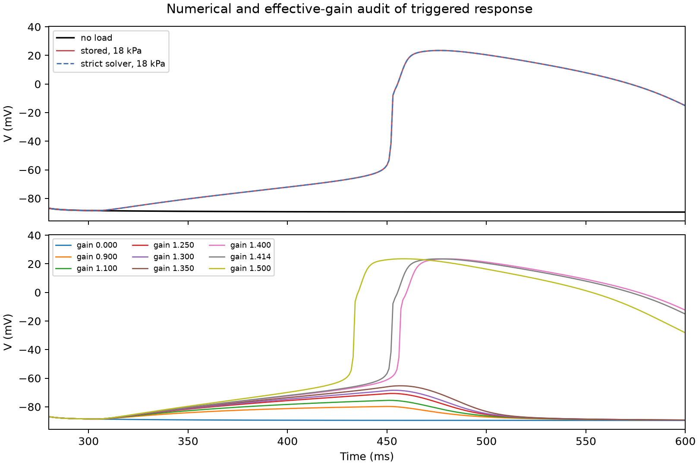

# 外力驱动闭环细胞的完整轨迹空间：固定规则的小样本去留检验

日期：2026-10-18。此报告记录 51 状态 ToR-ORd/SAC–Land **计算模型内部**的结果，不把它称为经过实测校准的人心肌数字孪生。

## 工程边界与研究问题

已验证的 50 状态电/Ca/Land 方程加一个**内生肌节长度**状态：

\[
\eta\dot\lambda=P_0+P_{\rm external}(t)-K(\lambda-1)-T_{\rm Land}(t).
\]

求出的长度同时进入 Land 收缩与拉伸相关电反馈；因此模型可做“外载→长度→电/Ca→张力→长度”的闭环虚拟干预。`K`、`η`、外载量级尚未经配对真实形变/力/电记录校准，且仅有**一维长度**，没有二维细胞轮廓。数值检查：名义模型更严格求解器与原设置的电压 MAE 为 0.000278 mV、Ca MAE 为 1.44×10⁻⁶ µM、长度 MAE 为 8.53×10⁻⁷；本次参数化导数的直接计算和 TorchScript 追踪最大差约 10⁻⁸。有效电反馈增益为拉伸相关电学 RHS 的缩放，**不是**已测单一 SAC 电导。

本阶段不继续扩展反馈方程或训练形变网络。要先问：**在外力控制、长度内生的条件下，校准挑战是否把相似虚拟细胞排成更符合未来电/Ca/张力/长度响应的关系？**

## 固定实验设计

两批互不重合的 Latin-hypercube 参数队列，各 12 个虚拟细胞；只改变有效 SAC 缩放、Land `β1`、外层机械刚度和黏性。每个细胞都从**同一个名义 50 状态预起搏初态**与 λ=1 开始，分别模拟 600 ms：无载、12 kPa/250–350 ms 校准、18 kPa/300–450 ms 强负载目标、12 kPa/400–500 ms 晚相目标。四条是重置初态后的**配对虚拟实验**，不是同一细胞连续施加四次刺激；所以不能检验跨搏记忆。共完成 24×4=96 条、每条 601 个时间点的 V/Ca/T/λ 轨迹，无求解失败或预设 λ 范围 QC 失败。

这四个变化参数都直接或间接作用于机械响应，而离子电流与 Ca handling 的基线参数固定。**基线电生理异质性明显少于真实细胞**，所以挑战带来的可观测性优势可能被放大；此队列是检查外力边界和轨迹空间能否运行的 pilot，不是充分的个体化 population benchmark。

评分使用每个有载轨迹减去相同细胞无载轨迹，避免把自然 AP/Ca 时间过程误当外载效应。校准轨迹每 5 ms 取样；未来标签是两个预先指定目标的**完整**响应轨迹。四模态以源队列定义的尺度归一：1 mV、0.005 µM、1 kPa、0.01 长度单位；欧氏分数是**无量纲轨迹距离**，不是 mV MAE。确认队列不参与尺度、PCA 或 ridge 拟合。检查近邻未来距离、所有细胞对的距离排序、固定 α=1 岭回归；另有复制基线及打乱校准细胞标签的对照。

## 结果一：轨迹具有任务相关的连续梯度，但幅度和近邻不完全稳定

源队列校准响应 PCA 第一轴解释 86.5% 方差，与有效**拉伸电学响应**增益（代码名 `sac_gain`）的 Spearman ρ=0.965；源队列冻结 PCA 投到确认队列后 ρ=0.972。`β1` 的关系分布在其他多个轴上，不能说一个轴就是一个分子参数。校准响应图总体呈**连续梯度**，没有充分证据推断离散细胞群或内在流形维数；参数先验本来就是连续抽样，24 个细胞不适合做 persistent homology 或群数判定。

| 预设检验 | 源队列 | 独立参数确认队列 |
|---|---:|---:|
| 基线距离与未来距离 Spearman ρ | 0.048 | 0.075 |
| 加校准挑战后的同一 ρ | 0.542 | 0.505 |
| 2 近邻的未来轨迹距离，基线→加挑战 | 4.224→3.763 | 0.948→0.631 |
| 挑战带来近邻改善的细胞 | 10/12 | 8/12 |
| 打乱挑战对应关系的经验单侧 p | 0.322 | 0.001 |
| 留一细胞 ridge，基线→加挑战 | 3.648→3.302 | 0.772→0.444 |

源队列近邻改善的均值很不稳定，按细胞重抽样差值区间 −1.88 至 2.87；确认队列的区间为 0.154 至 0.476。源队列的留一 ridge 差值区间也跨零。**两队列都显示距离排序更贴近未来响应；近邻和同队列预测增益的强度并不稳定。**

## 结果二：空间的关联不能直接变成已迁移的预测器

用源 12 个细胞训练并完全冻结的 ridge，预测确认 12 个细胞时，未来轨迹距离从**仅基线 1.871**变为**基线+挑战 2.041**，12 个中只有 5 个受益；复制基线对照为 1.889。这直接否定“加入挑战后固定线性映射必然可迁移”的强说法。确认队列自身留一训练的改善不能替代这个独立训练→测试结果。源/确认虽然参数范围相同，但源队列包含一个强负载下的极端事件；当前小样本的线性映射受它影响很大。事件的数值与因果审计见下节。

**事后影响审计**：保持同一 ridge，只从源训练集中逐个排除一名细胞。排除事件细胞 2 后确认误差降为 **0.467**；排除其他任一细胞时为 **2.037–2.395**。这明确定位了训练映射被少数事件样本拉偏，但因为排除决定是在看到确认结果后作出的，**0.467 不是无偏的正式方法成绩**。下一版必须在开发集定义事件识别/稳健映射规则，再拿全新队列检验。

## 结果三：强挑战下出现一个待审计的事件型分支

源细胞 2 的 18 kPa 目标在约 **456 ms** 跨过 0 mV，最大受载–无载电压差约 **113 mV**；其余 23 个虚拟细胞的相应最大差不超过约 22.3 mV。该事件在强负载脉冲停止后出现，符合刺激期间缓慢去极化后由细胞内电动力学触发额外 AP 的模型路径。更严格求解与原设置的 V 轨迹 MAE 仅 **0.000576 mV**，最大差 **0.0147 mV**，排除了当前求解容差导致的假事件。

固定该细胞 `β1`、刚度与黏性，只扫有效电反馈增益：增益 **1.35** 时负载后的最高 V 为 **−65.3 mV**，**1.40** 时跃升至 **+23.47 mV**；增益为零时没有额外 AP。零增益关闭的是整个“伸长相对于 λ=1 的电学 RHS 差分”，TnC/Ca 路径仍保留；结果只支持**拉伸相关电学路径对该事件必要**，不能归因于某一个分子 SAC 电流。这支持**当前方程和强负载协议里的事件型动力学边界**。阈值位置依赖其余细胞参数及未校准的 18 kPa 载荷，不能据此推出真实心肌的阈值，更不能把一个事件样本当作两个稳定的生物细胞亚群。24 细胞其余部分沿“有效增益×峰值伸长”的启发性输入近似平滑上升；因此当前结果是**连续响应梯度 + 协议特异事件边界**，而非简单二选一。

再对 **1.35** 和 **1.40** 两端分别使用严格 BDF（rtol 10⁻⁸、atol 10⁻¹⁰、max step 0.5 ms）：最高 V 分别为 **−65.295** 与 **+23.467 mV**，事件边界的这两个端点未随求解精度翻转。该扫描只在一个细胞其余参数固定时成立，不是群体阈值估计。

## 现阶段判断

已完成一个可运行的**一维外力驱动闭环计算平台**及两队列完整轨迹实验。计算内部的校准响应空间有稳定的连续有效拉伸电学增益梯度，机械挑战通常让观测距离更贴近未来响应；但冻结监督预测器未提升独立队列，强负载还可跨越事件边界。这说明轨迹空间可能需要同时表达**平滑功能坐标和动力学事件风险**，单一线性映射会把两者混淆。现在**不能**宣称已经发现真实心肌的离散/连续力电状态空间，也不能称闭环数字孪生已被真实数据验证。下一阶段最关键的是机械边界参数与真实同步 AP/Ca/形变/力的校准，并在不同方程体系检验该几何方向；不需要为了这一步再加自由神经网络。

代码和原始计算产物：`run_embodied_cohort.py`、`score_embodied_cohort.py`、`score_embodied_transfer.py`、`audit_triggered_response.py`、`audit_source_influence.py`、`embodied_cohort/`、`embodied_cohort_confirm/`、`embodied_transfer_score.json`、`triggered_response_audit.json`、`source_influence_audit.json`。
