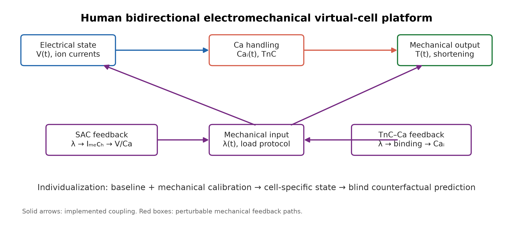
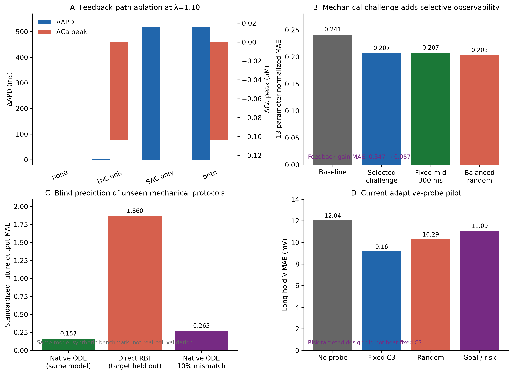
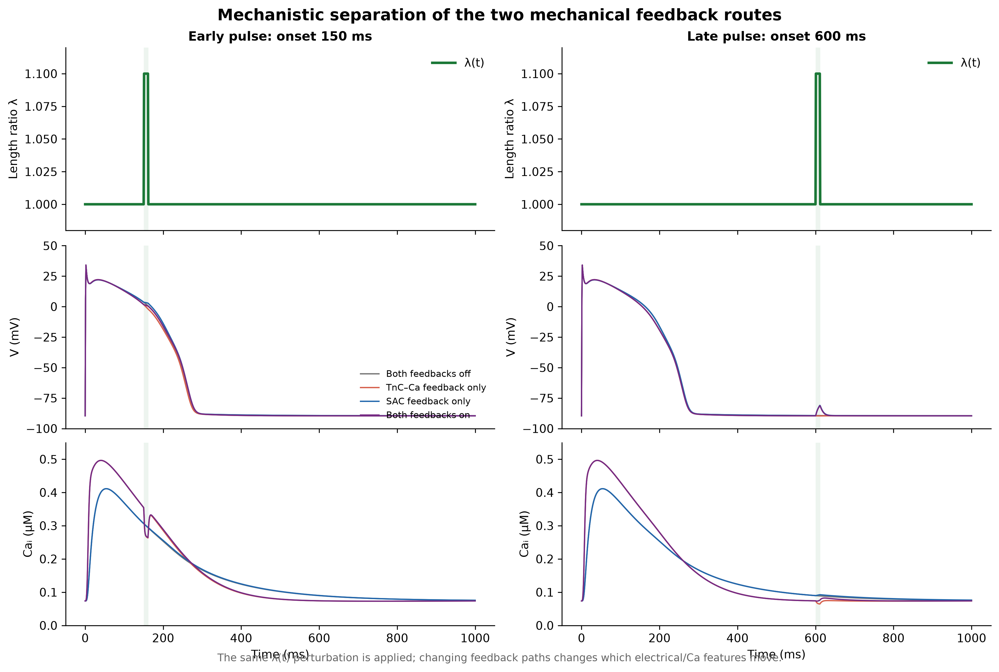
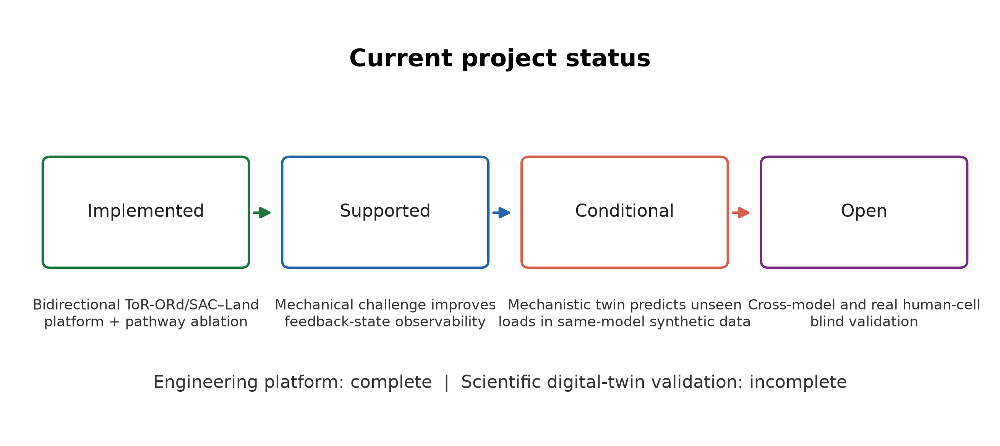

# 双向力电耦合虚拟心肌细胞平台：阶段性汇报

## 一句话结论

目前已经完成了一个可运行、可做机械干预实验的人源双向电—钙—收缩虚拟细胞平台，并在同一方程体系的合成细胞中证明：机械挑战可以增加某些隐藏反馈状态的可观测性，机制模型也能预测未见机械负载下的响应。平台的工程实现和数值验证已经完成，但真实人源机械挑战验证、跨模型验证和可靠不确定性评估尚未完成，因此目前应称为“人源方程驱动的双向虚拟实验平台”，不应称为已经验证的真实人心肌数字孪生。

## 图 1：平台结构

平台包含三条方向明确的关系：

1. 电活动产生胞质 Ca；
2. Ca 和 TnC 状态驱动 Land 收缩模型，得到张力；
3. 机械长度输入通过 SAC 和动态 TnC-Ca 两条反馈路径反过来影响电压和 Ca。

两条反馈可以分别打开或关闭，因此可以区分“机械只改变张力”和“机械真正反过来改变电/Ca”的情况。

需要强调：当前机械输入是指定的肌节长度轨迹 λ(t)，不是由真实力传感器测得的细胞力，也没有完整 afterload 力平衡方程。

## 图 2A：反馈通路消融

在 λ=1.10 的持续机械负载下：

- 两条反馈都关闭时，APD 和 Ca 峰几乎不变，说明模型数值上没有把机械负载错误地传入电活动；
- 只打开动态 TnC-Ca 反馈时，APD 变化很小，但 Ca 峰下降约 0.104 µM；
- 只打开 SAC 时，APD 显著延长；
- 两条反馈都打开时，两种效应叠加。

这个结果的意义是：平台中的两条反馈路径确实闭合，并且有可分离的功能作用。它主要证明模型实现和机制方向正确，不是一个新的生物学机制发现。

## 图 4：直接看机制如何改变波形

这张图比单纯的柱状图更直接地展示机制：上排是同一个机械长度脉冲，中排是膜电压，下排是胞质 Ca。左列在动作电位早期施加刺激，右列在 600 ms 的晚期施加刺激。

- 早期刺激时，SAC 主要改变复极过程，动态 TnC-Ca 反馈主要改变 Ca 瞬态；
- 晚期刺激时，完整 SAC 路径可以在基线复极后诱发明显的局部电压偏移，而 TnC-Ca 路径更多表现为 Ca 的局部变化；
- 这说明机械输入的作用不仅取决于幅度，还取决于它进入动作电位和 Ca 循环的时间位置。

因此平台模拟的不是一个静态的“长度—电流”映射，而是一个具有时间状态和反馈路径的动态系统。

## 图 2B：机械挑战增加选择性可观测性

在 64 个同时改变电、Ca、收缩和反馈参数的虚拟细胞中，只使用基线观测时，13 参数归一化误差为 0.241；加入机械挑战后下降到约 0.207。更关键的是，反馈增益误差从 0.347 降到 0.057。

这说明机械挑战并不会让所有参数都同样容易识别，而是选择性地增加与机械反馈直接相关的状态信息。这个“选择性可观测性”是目前最值得保留的科学主线。

## 图 2C：未见机械协议预测

在同一 ToR-ORd/SAC–Land 方程体系的合成数据中，机制模型可以把基线和机械校准观测送回原方程，预测训练中完全封存的机械协议。标准化误差约为 0.157，而不含目标协议训练结果的直接 RBF 为 1.860。

但这个结果的正确表述是：

> 在同一机制模型生成的合成细胞中，机制闭环对未见机械协议具有较好的结构外推能力。

它不能直接证明模型已经能预测真实人心肌细胞。

## 图 2D：主动探针设计目前没有成功

目前尝试了一个面向未来长时预测风险的个体化机械探针选择方法。探针库本身通过了仿真 QC，但在 47 个开发细胞的留一测试中：

- 固定 C3：9.16 mV；
- 随机安全探针：10.29 mV；
- 目标/风险定向探针：11.09 mV。

因此目前不能声称已经提出有效的主动机械实验设计算法。这个负结果说明：群体响应多样性不等于能够有效消除长时反事实预测歧义，当前候选孪生集合和探针库还不够适合这个任务。

## 图 3：当前完成度

### 已完成

- 人源 ToR-ORd/SAC–Land 双向耦合代码；
- SAC 和动态 TnC-Ca 反馈的独立消融；
- 严格预起搏和求解器稳定性检查；
- 13 参数异质性虚拟细胞队列；
- 机械挑战可观测性分析；
- 未见机械负载的机制预测基准。

### 已获得的正结果

- 机械挑战能够暴露基线状态下不明显的反馈差异；
- 机械观测可以显著改善反馈增益等任务相关状态的识别；
- 在同模型合成数据中，机制闭环比简单直接映射更适合真正的未见协议外推；
- 机械反馈效应具有明显的刺激相位依赖。

### 当前边界

- 双向模型结构本身并非首次提出，已有 ToR-ORd/Land 和 SAC 相关工作；
- 目前没有真实人源单细胞的基线—机械校准—盲机械挑战数据；
- 还没有独立的人源 electromechanical 模型作为真值进行跨模型测试；
- 当前局部后验预测区间覆盖率不足，不能声称不确定性已经校准；
- 主动探针算法尚未超过固定协议。

## 给老师汇报时建议使用的结论

建议这样表述：

> 我目前完成的不是一个已经被真实细胞验证的完整数字孪生，而是一个可以进行双向机械干预的、方程驱动的人源虚拟心肌细胞平台。平台已经通过反馈路径消融和数值稳定性检验。在合成虚拟细胞中，机械挑战能够选择性提高力电反馈状态的可观测性，并支持对未见机械条件的机制外推。下一步的关键不是继续堆更大的网络，而是用独立模型和真实机械挑战数据验证这一可观测性规律是否具有可迁移性。

## 下一步建议

优先级应是：

1. 用第二套独立人源 electromechanical 模型做 cross-model truth；
2. 建立包含基线、校准机械挑战和盲机械挑战的最小真实数据接口；
3. 在这些验证完成前，不继续把 PINN、Transformer 或高阶网络作为主贡献；
4. 若跨模型规律仍成立，再发展任务相关 latent state 或机制不确定性模型。

## 新增：神经网络行为还原与可视化原型

参考线虫脑—身体—环境闭环建模的思路，已经做了一个小型神经网络虚拟细胞原型。它输入时间、机械长度、刺激相位以及两条反馈通路状态，输出膜电位、胞质 Ca 和 TnC 状态，并把这些状态实时映射到一个动态细胞示意图：细胞宽度表示机械长度，膜颜色表示电位，胞质颜色表示 Ca。

第一版八条轨迹解码器的训练重建误差为：V 约 3.43 mV，Ca 约 0.00604 µM，TRPN 约 0.00399。随后又使用 47 个有效虚拟细胞进行按细胞留出训练，加入基线条件并预测相对响应；12 个留出细胞上的误差为 V 0.994 mV、Ca 0.03299 µM、张力 0.158 kPa。这个结果说明基线条件化的神经行为解码器比单纯递归滚动更稳定，但所有六类协议都曾出现在训练集合中，尚未构成真正的未见协议外推。

原型文件：

- [虚拟细胞动画](virtual_cell_prototype/virtual_cell_demo.gif)
- [原型说明](virtual_cell_prototype/README.md)
- [原型脚本](prototype_virtual_cell.py)
- [基线条件化虚拟细胞动画](virtual_cell_decoder/conditioned_virtual_cell.gif)
- [基线条件化解码器说明](virtual_cell_decoder/README.md)
- [解码器脚本](train_conditioned_behavior_decoder.py)

进一步的协议盲测也已经完成：完全封存长时保持协议，只用其余五类机械协议训练，在 12 个留出细胞上预测该长时协议。结果为 V 3.09 mV、Ca 0.0246 µM、张力 0.111 kPa。

- [协议盲测图](virtual_cell_unseen_protocol/blind_protocol_prediction.png)
- [协议盲测指标](virtual_cell_unseen_protocol/metrics.json)
- [协议盲测脚本](train_unseen_protocol_decoder.py)

这证明网络不是完全依赖长时协议的逐条记忆，但仍属于同一机制模型内部的合成验证；下一步需要跨模型和真实数据测试。

## 文件

- [平台架构图](report_figures/fig1_platform_architecture.pdf)
- [核心结果图](report_figures/fig2_core_results.pdf)
- [项目状态图](report_figures/fig3_status_ladder.pdf)
- [图形生成脚本](make_report_figures.py)
- [双向模型核查报告](human_feedback_bridge_report.md)
- [六层检验记录](human_feedback_six_gate_report.md)
- [主动探针设计报告](predictive_disagreement_design_report.md)
