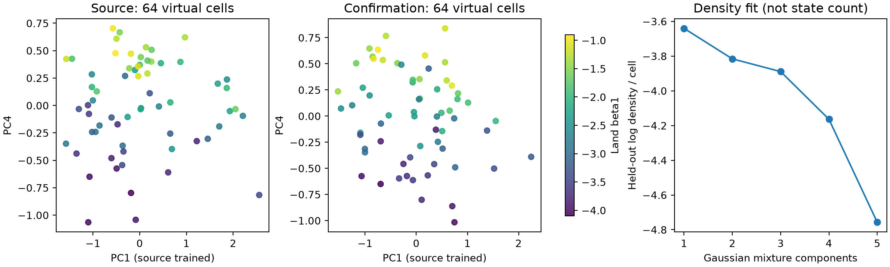

# 闭环力电细胞与干预条件下的状态空间：三篇论文对照及首轮检验

日期：2026-10-18。目标是一个可施加机械与电学干预、同时输出电压、Ca、张力和形变的闭环虚拟细胞，并判断不同参数及干预在**可观测功能空间**中的变化是连续梯度、离散状态，还是两者共存。本报告是研究设计和现有数据的首轮实测审计，不声称已发现真实细胞的普适流形。

## 三篇论文分别提供什么

| 论文 | 真正可借鉴的结构 | 本项目需要补的环节 |
|---|---|---|
| BAAIWorm，Nature Computational Science 2024，doi:10.1038/s43588-024-00738-w | 生理网络、可变形身体、环境输入和感知反馈构成可扰动闭环；作者用实际行为与网络扰动检验。其核心不是给模型做动画。 | 目前有人心肌 AP–Ca–T–λ 的一维方程闭环；还没有经过真实数据检验的二维细胞几何、边界条件和环境接触。 |
| Sebastian 等，Nature Neuroscience 2023，doi:10.1038/s41593-023-01471-9 | 先用已知连续/分群的合成波形检验拓扑方法，再分析真实高维波形，最后将坐标与独立的输入机制测量联系。10,741 个事件，58 个 session、27 只小鼠；其一组稳定结果是连续分布和约 4 维内在维数。 | 我们应先定义一个有盲测未来响应意义的距离，再检验连续/分群；现有 64+64 合成细胞不能直接照搬其 persistent homology 或宣称内在维数。 |
| Rühl 等，Nature Communications 2026，doi:10.1038/s41467-026-76758-z | 同时量测细胞群电压与 Ca，并通过连接蛋白干预区分局部 Ca 与群体同步 Vm；等效电路预测电压波动随电连接细胞数约按 1/n 降低。 | 它是非兴奋性细胞的**群体电学**研究，不是心肌力电耦合验证。只有在单细胞闭环的细胞间电连接/力学耦合被明确定义后，才适合作为群体分支的设计范式。论文的 Source Data 含图表底层轨迹，但完整原始影像需向作者索取。 |

## 已有平台的准确完成度

当前人模型包含 ToR-ORd/SAC–Land 的 AP→Ca→T，以及伸长经 SAC 和 TnC/Ca 回到电/Ca。近期的一维自由长度版本增加了外界力、主动张力、弹性和黏性共同决定的 λ，而不是直接指定 λ(t)。因此**方程级闭环已可运行**，并经过求解器容差一致性检查。它尚非完成的可验证“数字线虫式”细胞：K、η、外力和几何都未由配对实验识别；示意 GIF 不是实测二维轮廓。详见 `shape_feedback/README.md`。

已有同方程的 64 细胞开发队列和独立种子的 64 细胞确认队列。每颗细胞的 13 个参数在各机械协议下保持不变。原先分析显示 300 ms 挑战把“观测近邻的未来功能距离”从 1.147 降为 0.666，确认队列从 1.221 降为 0.641；同方程的 5 维 PLS 预测也有效。然而另一套人模型 ORd–MechChem 的 19 细胞检验仅有很小的 AP/Ca 近邻改善，置信区间跨零，而且原坐标不能有效转移。因此**功能邻域重排已有同方程证据，普适跨模型空间尚未成立**。

## 首轮“离散还是梯度”审计

代码：`three_paper_state_space_gate.py`；机器可读结果：`three_paper_state_space_gate.json`；图：`three_paper_state_space_gate.png`。使用原先冻结的基线+300 ms 长度挑战观测和源队列特征尺度。PCA 只在源队列拟合，确认队列原样投影。五维是预先沿用的预测工作坐标，**不是本次估出的内在维数**。

### 离散成分

- 对五维源坐标，单高斯的 BIC 为 **560.8**；2、3、4、5 成分分别为 **616.4、662.9、698.7、756.8**，均更差。源队列拟合后，单高斯在确认队列上的每细胞 log density 也最高（−3.64；2 成分 −3.82）。混合高斯成分数本身不等于生物状态数，只作为密度反证。
- 为避免把单个离群点当成群体分裂，最小生成树只考虑切开后两组都至少有 8 个细胞的边。最大边/中位边比在源队列 **1.27**、确认队列 **1.33**；都未超过各自协方差匹配连续高斯抽样的 95 百分位（**1.37、1.35**）。这不是完整 persistent homology，只是小样本的 H0 分离代理。
- 两批数据均**没有给出稳定离散分群证据**。这不证明真实细胞空间一定连续：参数原本由连续 Latin-hypercube 抽样，64 细胞对稀有动力学分支的检出力很有限，协方差匹配高斯也不是所有连续流形的充分零假设。

### 可解释梯度

- 在源队列探索 5 个 PC×13 个真参数后，最强的是 **PC4–Land β1**，Spearman **ρ=0.865**；对 65 项扫描做最大统计量置换，经验 `p≈0.001`。冻结该轴并投影独立种子确认队列，**ρ=0.876**。
- β1 在仅有基线的三个 PCA 坐标中，源队列相关为 **0.180、0.148、0.054**；确认队列为 **−0.035、0.093、0.013**。这符合模型方程：λ=1 的基线不提供 β1 的长度依赖信号，机械挑战才把这一方向暴露出来。
- β1 是**仿真真参数**，并非真实细胞的已测潜在坐标。PC4 也只解释源观测方差的 **8.85%**；它有可重复的参数含义，不意味着整个生理空间只有一个轴，更不意味着已找到离散“细胞类型”。

## 下一阶段的固定研究框架

1. **把“身体”做成可检验的机械自由度。** 继续保留当前 ODE 的电/Ca 状态，张力驱动长度/位移场，反过来影响 SAC 和 Ca–TnC；每一步记录功、张力、长度与离子/Ca 守恒，分别关掉两条反馈验证因果通路。二维渲染只能由求解的位移场产生，并须和真实轮廓/肌节轨迹比对。
2. **状态空间的对象是一个细胞的多次干预响应，不是参数的漂亮散点。** 输入至少包括基线、机械挑战、封存未来协议的同步 V/Ca/T/λ 轨迹。先做时间对齐、信噪、批次和细胞级划分；用真实未来响应定义功能等价，再检验观测距离是否对应这种等价。数据允许时，先检 H0/分群与连续梯度的合成阳性/阴性对照，之后才考虑 H1、内在维数或高阶网络。
3. **机制坐标必须经扰动验证。** 分开改变 SAC、Ca handling、Land 长度敏感性、外部弹性与黏性；将每个方向画成同一细胞在状态空间中的轨迹，问方向能否在新种子、新协议和第二方程族重现。尤其不能把源模型的 PC4–β1 直接宣称跨模型通用。
4. **群体分支是明确的备选问题。** 若单细胞二维形变和状态空间缺乏配对数据，则把可运行单细胞作为节点，显式加入 gap-junction 电流、细胞间力学连接和可控环境，检验同步、传播、波动抑制及机械扰动的空间范围。Rühl 论文给的是电耦合的判别范式；心肌网络中的力电集体现象需要新的方程与匹配验证，不能直接继承其 1/n 定律。

## 当前去留判断

**单细胞闭环平台：继续，但按“可扰动方程原型”表述。** **状态空间：继续检验连续梯度，暂不写离散生物状态、persistent homology 或普适流形。** PC4–β1 是一个很好的内部阳性对照；下一关是确认电反馈方向、几何方向和未来响应是否在**完整轨迹、新协议、异方程和真实同步测量**下同时保留。若不保留，就转向具有独立集体现象和配对记录的细胞群体问题，而不是仅把网络做大。
