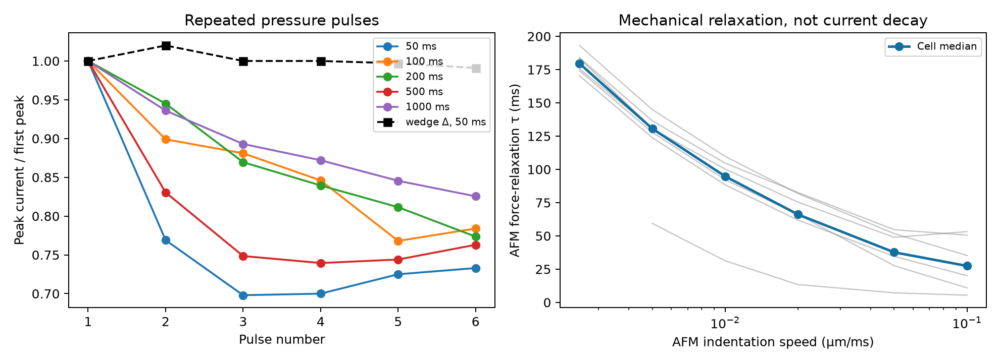

# 2026 PIEZO1 wedge 论文 Source Data：恢复与机械松弛审计

日期：2026-09-27。来源：[Roettger 等，Nature Communications 2026](https://www.nature.com/articles/s41467-026-76927-0)；本地原始 Source Data：[41467_2026_76927_MOESM4_ESM.xlsx](../Data/41467_2026_76927_MOESM4_ESM.xlsx)。此分析只使用 `Fig3A`、`FigS4A`、`Fig1J`、`Fig1K` 四张表，并与论文方法核对。**这套数据支持在模型中区分压力脉冲后的通道可用性与 AFM 压入后的细胞力松弛，但目前不足以给 Duke 固定单一恢复时间常数或“速度→Piezo 电流”函数。**

## 1. 重复压力刺激：存在状态历史，但恢复时间尚不可稳健定量

论文在 N2a-P1KO 细胞表达 PIEZO1，以 cell-attached patch、−60 mmHg、每脉冲 250 ms 记录峰值。六脉冲系列的间隔为 50、100、200、500、1000 ms，间隔期间施加 +5 mmHg。不同间隔系列在**同一 patch 上依次进行，顺序为 1000→50 ms**；这是解释间隔效应时必须保留的实验顺序信息。表格未提供可可靠跨间隔配对的原始 patch ID 或连续电流波形。

`Fig3A` 的 WT 50 ms 数据与 `FigS4A` 的对应 9 列逐单元完全相同，程序已检查且只计一次。50 ms 组的第 6 次/第 1 次峰值比为：

| 条件 | 独立 patch 数 | 第 6 次/第 1 次峰值中位数 |
| --- | ---: | ---: |
| PIEZO1 WT | 9 | **0.733** |
| P1.wgDEL | 13 | **0.991** |

两组第 6 次比值的探索性双侧 Mann–Whitney `p≈0.00169`。wedge 缺失体在短间隔六次脉冲下几乎维持峰值，支持论文将 wedge 与通道失活联系起来的判断。这个机制推断来自**压力钳 + 结构扰动**；Duke 的 AFM poking 电流衰减仍不能全部命名为 channel-intrinsic inactivation。

WT 不同间隔的逐细胞峰值比中位数如下；每列 n 是该间隔组的 patch 数，各组不能据工作簿列位置强行配成同一 patch：

| 间隔 | n | 第 2 次/首次 | 第 6 次/首次 |
| ---: | ---: | ---: | ---: |
| 50 ms | 9 | 0.769 | 0.733 |
| 100 ms | 7 | 0.899 | 0.784 |
| 200 ms | 8 | 0.945 | 0.774 |
| 500 ms | 6 | 0.830 | 0.763 |
| 1000 ms | 8 | 0.936 | 0.825 |

1000 ms 组有一列第 2–6 次峰值比均约 `5×10⁻¹¹`、首次比为 1；这是待核的极端记录，本次**保留在原始导出、用中位数减少其影响**。该组均值会明显受其影响。间隔趋势总体支持短间隔可用性下降，但第 2 次峰值的 200 ms 比 500 ms 高，显示它不能被当成一条干净、严格单调的 recovery curve。

作为**失败诊断**，将五个间隔的第 2 次中位数拟合 `r₂(Δt)=1−a exp(−Δt/τ)`，得到约 `τ=1.41 s`；逐一留掉一个间隔后，`τ` 从约 **0.079 s 到 14.3 s**。模型没有处理顺序、patch 差异、+5 mmHg 期间状态和第 3–6 次序列。因此 **1.41 s 不是可移植给 Duke 的生物物理先验**，不应画成已识别的 PIEZO1 固有恢复时间。源数据直接支持的是“50–1000 ms 范围内响应受到刺激历史影响”；Duke 的约 5 s 刺激间隔是否完全恢复，不能用这些点外推判定。

## 2. AFM 速度：测得的是细胞力松弛，不是电流速度响应

`Fig1J/K` 在 7 个 N2a-P1KO 细胞上测定 tipless AFM ramp-and-hold 压入，速度 `0.0025–0.1 μm/ms`。每速度每细胞至少重复 5 次；Source Data 报的是**细胞均值**，不是 5 次重复各自的独立点。最慢速度只有 6 个细胞有值。采样率为 2048 Hz。

| 压入速度 (μm/ms) | 细胞数 | 力松弛 `τ` 中位数 (ms) | 保持期末力/初峰中位数 |
| ---: | ---: | ---: | ---: |
| 0.0025 | 6 | 179.62 | 64.72% |
| 0.005 | 7 | 130.59 | 60.06% |
| 0.01 | 7 | 94.82 | 53.01% |
| 0.02 | 7 | 66.12 | 46.47% |
| 0.05 | 7 | 37.67 | 40.48% |
| 0.1 | 7 | 27.43 | 39.90% |

在同时有最快与最慢条件的 **6 个相同细胞** 中，最慢速度的力松弛时间中位数为 **179.63 ms**，最快为 **31.35 ms**；保持期残余力中位数为 **64.72%** 与 **42.44%**。六个细胞在这两个终点的方向均一致。这复现了论文最快速度的总体均值 `28.99±18.51 ms` 和 `35.18±14.49%`（均值±样本 SD，n=7），为仿真器的**机械松弛层**提供独立约束。

**关键区分：** 论文的 AFM 速度系列记录的是作用于悬臂的力随时间如何变化；没有同时记录这些速度下的 PIEZO1 电流峰值。这套 Source Data 不能直接建立 `loading velocity→I_peak`，也不能把 AFM 力松弛 `τ` 当成通道失活 `τ`。论文所用 N2a、AFM 几何和速度也与 Duke HEK293T 体系不同。

论文还报告 poking 电流的表观衰减时间：WT 约 **9.8 ms**，wedge 缺失体约 **15.8 ms**，而压力钳下 wedge 缺失体的失活影响更强。作者据此指出，poking 的电流下降仍可能包含机械力松弛造成的去激活；这与上面的 AFM 力实验在物理上相互印证，但两组记录不是同一条同步力电波形。

## 接入现有仿真器的边界

1. 将 `机械保持期力松弛` 和 `压力撤除后的响应可用性` 表示为**两个不同状态/模块**。前者由 `Fig1J/K` 约束方向和量级，后者由 `Fig3A/S4A` 证明存在；不要把两者合并成一个“Piezo 失活常数”。
2. 若以后用 Duke 的 5 s 间隔建立幅度迁移模型，保留 sweep 历史或做无历史/有历史的预测对照。但不能仅由这套 50–1000 ms、顺序变化的压力数据指定 Duke 的恢复速率。
3. 想独立识别恢复动力学，优先考虑**同一 patch 随机化间隔顺序**、各间隔足够长的重置、原始连续波形及 patch ID；想区分机械松弛与通道失活，需同步测力与电流，最好包含保持期和重复刺激。

复现：[分析代码](wedge_source_data_analysis.py)、[限定实验条件的约束接口](external_mechanics_constraints.py)、[数值摘要](wedge_source_data_results.json)、`wedge_recovery_wt.csv`、`wedge_recovery_mutant_50ms.csv`、`wedge_recovery_interval_summary.csv`、`wedge_recovery_tau_sensitivity.csv`、`wedge_afm_velocity.csv`、`wedge_afm_velocity_summary.csv`。没有修改下载的工作簿。
